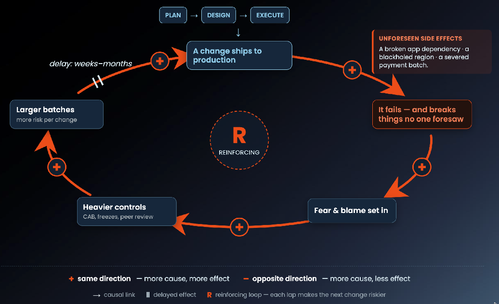
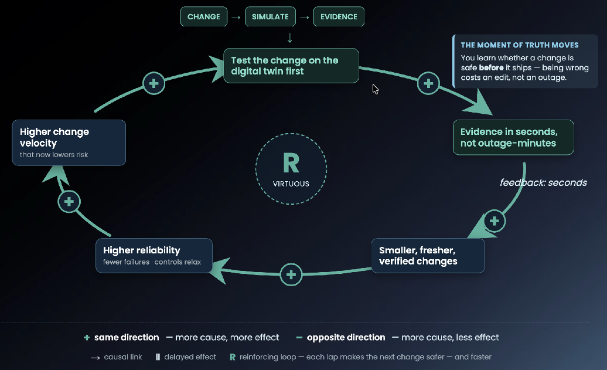
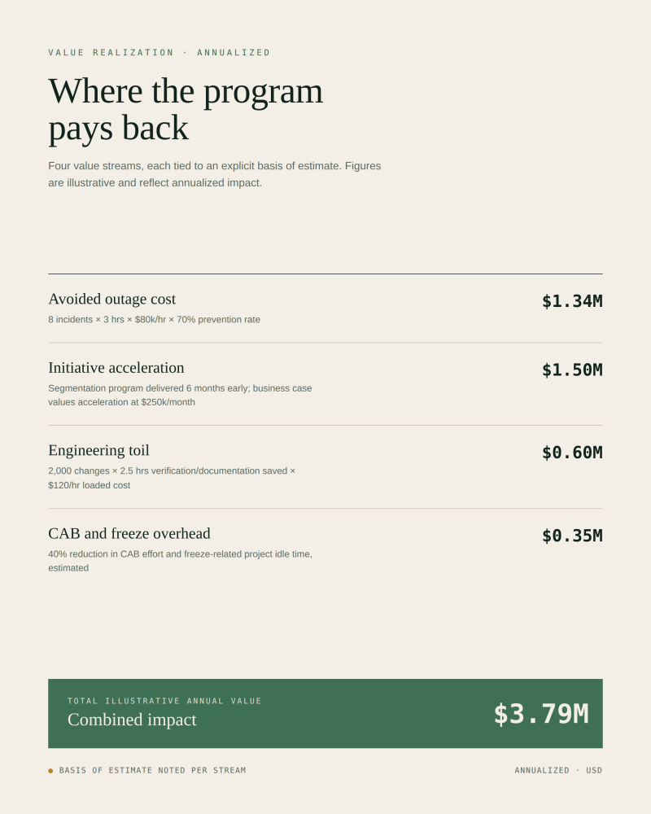

## A Systems Approach to Safe, Fast Network Change

A whitepaper on applying System Dynamics to network change management, and the business case for pre-change simulation

## Executive Summary

Network change is one of the riskiest things an enterprise does to itself. A single routing or firewall edit can quietly break an application dependency, pull reachability from a whole region, or take the business offline for hours.

The usual response (freezes, heavier approval boards, rarer maintenance windows) feels like risk reduction but isn't. Research from MIT Sloan's System Dynamics group shows it does the opposite. Each control added after a failure quietly raises the odds of the next one, and the organization spends years tightening the loop on itself.

This paper applies that systems view to network change. It explains why change-induced outages keep happening even at the most sophisticated operators, why conventional controls fail to stop them, and how pre-change simulation, which tests routing and firewall changes against an accurate model of the production network, breaks the failure loop at its two weak points: how long feedback takes, and how much risk each change carries.

The argument in brief: today, organizations find out whether a change was safe in production, after the fact, and they pay for the answer in outage minutes. Simulation moves that moment of learning ahead of deployment and drops the price to seconds. Everything else follows from that one shift: fewer outages, faster delivery, smaller and safer batches, lighter approval overhead. The payoff isn't only defensive. Avoided downtime is the floor. The real return is that the network stops being the thing every strategic initiative has to wait on.

## The Problem: Change Is Where Networks Break

Mature networks rarely fail on their own. Hardware is redundant, links are diverse, and the protocols are built to route around damage. What none of that protects against is a change that executes a wrong intention perfectly: a configuration edit that does exactly what it was told, when what it was told was wrong.

Ask any senior network operations leader how many of their serious incidents started with a planned change. The answer is rarely under half, and in plenty of shops it's most of them.

The damage scales with the network's blast radius, and the public record is vivid enough. In October 2021, a configuration change made during routine maintenance on Meta's backbone cut its data centers off from the internet. The change withdrew the BGP routes that kept [facebook.com](http://facebook.com), Instagram, and WhatsApp reachable. The outage ran about six hours, made worse by the fact that Meta's own recovery tooling sat behind the same network it had just taken down.

In July 2022, a maintenance update to the core network at Rogers Communications set off a cascading routing failure that took wireline and wireless service across Canada down for most of a day. Emergency calling went with it, along with hospital communications and the Interac payment network that a large share of the country's retail commerce runs on.

In June 2022, a BGP configuration change during an infrastructure rollout at Cloudflare knocked out nineteen of its busiest data centers, disrupting a meaningful slice of global internet traffic for more than an hour.

Three things tie these incidents together. Each came from a planned, reviewed, approved change run by a strong engineering organization, so process maturity didn't save anyone. Each failure was knowable beforehand; the post-incident write-ups describe behavior that an accurate model of the network would have predicted from the proposed change. And each company responded by tightening its change controls, which, as the next section argues, is the exact response that keeps the problem alive.

The same pattern repeats inside every enterprise at smaller blast radius and far higher frequency: the firewall cleanup that severs a payment job's database connection, the route-map edit that blackholes a branch office, the ACL change that breaks replication between two data centers. On their own, these are postmortem footnotes. Together they set the tone of the whole organization's relationship with its network, and that tone is fear.

## The Systems View: Why Change Controls Backfire

### The capability trap

MIT Sloan professors Nelson Repenning and John Sterman, studying process improvement and firefighting, named a pattern they call the capability trap. The title of their best-known paper says it plainly: "Nobody Ever Gets Credit for Fixing Problems that Never Happened." Under performance pressure, organizations consistently underinvest in capability (tools, testing, better process) and overinvest in firefighting, the heroic incident response. The reason is timing. Capability costs money now and pays back later, where nobody can see it; firefighting pays back visibly and right away. So the slide feeds itself. Less capability means more fires, more fires eat the hours that building capability would have taken, and the organization concludes, not unreasonably, that it's too busy to improve.

Network change management is a clean example. Walk through what happens after a change-induced outage.

A change fails in production and causes an outage. The organization responds with controls: a freeze, more approval gates, longer change advisory board (CAB) reviews, broader peer review. All of it slows how fast changes can ship. Business demand for change doesn't slow with it, so changes pile up and get batched into fewer, bigger maintenance windows. And bigger batches are riskier per change. More edits interact inside one window. The network state you assumed at planning time has drifted by deployment time. Rollback is harder to scope. When something breaks, diagnosis is harder because more things moved at once. Riskier changes produce the next failure, which produces more fear, more controls, bigger batches.

That's a reinforcing loop. A sensible, well-meant response to risk builds the conditions for the next failure. Every turn also wears down morale and skill. An engineer who pushes four changes a year through a wall of paperwork never develops the fluency of one who pushes four a week with fast verification.

### The misperception of feedback

So why do smart organizations stay stuck? Sterman's wider body of work has the answer: people are bad at reading systems where cause and effect are far apart in time. Between the cause here (batching changes) and the effect (a higher failure rate) sits a gap of weeks to months. When the failure finally lands, it looks like a single event with an obvious cause, the engineer who fat-fingered the prefix list, and not like the predictable result of a structural decision made last quarter. So the organization fixes the obvious cause, adds one more control, and tightens the loop another notch.

An accounting problem reinforces the blind spot. Outages get measured, escalated, and remembered. The cost of the controls does not. The engineer-hours burned on CAB paperwork, the strategic projects idling in the change queue, the risk quietly building inside ever-larger batches: none of it lands on a dashboard. The cost of moving fast is visible; the cost of moving slow is invisible. Weigh them against each other and slow wins every time.

### The leverage point

Systems theorist Donella Meadows ranked the ways you can intervene in a system in her paper "Leverage Points: Places to Intervene in a System." Tuning parameters (more headcount, longer windows, stricter thresholds) is the weakest lever there is. Changing a system's information flows and rules sits near the top. The network change loop has exactly one information flow worth changing: the moment the organization learns whether a change is safe.

Right now that learning happens in production, after deployment, with a delay measured in outage minutes and a cost measured in revenue and reputation. Every tool in the conventional kit (CABs, freezes, peer review) tries to cover that delay with human judgment. But a person reviewing a 400-line firewall diff against a mental picture of a 10,000-device network isn't really exercising control. They're performing a ritual.

Pre-change simulation changes the information flow itself. Run a proposed routing or firewall change against a high-fidelity model of the production network, one that captures its topology, its configs, and its routing state, and you learn what the change will do before it ships, in seconds, with zero blast radius. The loop that used to run change → production → outage → postmortem → fear now runs change → simulation → evidence → deploy or revise. The delay drops from weeks to seconds. The cost of being wrong drops from an outage to an edit.

That one structural change flips the loop's polarity. When verification is fast and cheap, small changes finally make sense, because each one is trivial to check. Small changes carry less risk. Less risk means fewer failures. Fewer failures let you relax the fear-driven controls. Relaxed controls raise change velocity. And higher velocity now lowers risk instead of raising it, because every change is smaller, fresher, and already verified. The doom loop runs in reverse. This is the same result the DORA and Accelerate research found for software delivery (Forsgren, Humble, & Kim, 2018), namely that speed and stability go together once feedback is fast, carried into the one place it has always seemed least believable: the production network.

## Practical Examples

The scenarios below are composites built from common enterprise failure patterns. Each sets the conventional change process against a simulation-gated one.

### The firewall cleanup that severs a payment job

Scenario. A security team runs its quarterly firewall cleanup and removes 180 rules that hit-count analysis flagged as unused over the past 90 days. One of them permits TCP/1521 from an application subnet to a database VLAN. It showed zero hits for a simple reason: the traffic it allows is a quarterly settlement batch job, and that job runs three days after the change window.

The conventional approach

- Execution: The change is peer-reviewed (one reviewer signing off on 180 deletions) and run during a weekend window.
- Validation: The team checks that production traffic is flowing. The quarterly job is idle, so the break stays invisible.
- Failure: Three days later, the job fails at 2 a.m.
- Impact: Diagnosis takes four hours. The change record is too vague ("removal of unused rules") to connect to the failure, and the on-call engineer belongs to the application team, not security. The settlement deadline slips, and the contract penalties land.
- Resulting control: The incident review adds another reactive rule. Every rule deletion now needs a 30-day comment period.

The simulation-gated approach

- Verification: Before the window, the proposed rule-base is loaded into the simulator next to the production model.
- Detection: The team runs a library of reachability invariants. One of them says the application tier must always reach the database tier on its service ports. The simulation flags that the change breaks the TCP/1521 path.
- Resolution: The engineer finds the quarterly job, keeps the rule with an annotation, and ships the other 179 deletions.
- Verification time: Minutes.

Key systems insight. The simulator never needed to know the job's schedule. It only needed the intended connectivity written down once, as an invariant, which turns a piece of tribal knowledge into a permanent, automatically enforced check.

### The route-map edit that blackholes a region

Scenario. Ahead of maintenance, a network team moves traffic off a data center by editing BGP route-maps to deprioritize its advertised prefixes. There's a subtle mistake in the edit: a prefix-list update uses a mask length that matches more prefixes than intended, including the summary route that covers a regional branch aggregation block.

The conventional approach

- Review: A senior engineer reviews the change and checks the route-map logic, but can't compute in his head how it interacts with 40,000 routes of live BGP state.
- Execution: It runs at 11 p.m. Within minutes, 60 branch sites lose connectivity to core applications.
- Recovery: Rollback restores service in 40 minutes, but the maintenance is scrapped and the window is gone.
- Impact: The team waits three weeks for another window, and the deferred maintenance now carries more risk than before.

The simulation-gated approach

- Verification: The simulator computes the full routing state the proposed route-map would produce and diffs it against the current state.
- Detection: The diff shows the intended deprioritization plus an unintended withdrawal of the regional summary route.
- Resolution: The engineer fixes the prefix-list mask, re-simulates, and runs a clean change.

Key systems insight. The consequences of a routing change are computable, but they aren't reviewable in anyone's head. Simulation swaps the reviewer's mental model for the protocol's actual arithmetic.

### The segmentation program that ships two quarters early

Scenario. An enterprise starts a zero-trust segmentation program that needs roughly 1,200 firewall and ACL changes across 14 sites. The current process (a biweekly CAB, monthly windows per site, batches of 30 to 50 rules) puts the forecast at 20 months. The CISO has committed to the board for 12.

The conventional approach

- Initial failures: Early batches cause two application outages from misjudged dependencies.
- Reactive control: The outages trigger a six-week freeze and a heavier review process.
- Outcome: The forecast slips to 24 months. Failure leads to control, control to slower delivery, slower delivery to bigger batches, bigger batches to higher risk.

The simulation-gated approach

- Codification: The team encodes the segmentation policy's intent as invariants: what must stay reachable, what must become unreachable.
- Optimization: Verification takes minutes instead of a CAB cycle, so batch size falls while throughput climbs.
- Acceleration: Incidents drop to near zero, which earns enough CAB confidence for standing pre-approvals.
- Outcome: The program finishes in 11 months.

Key systems insight. The binding constraint was never engineering capacity. It was the organization's safe change rate, and simulation is what lifted it.

## Articulating the Business Value

The business case rests on four value streams. The first is defensive. The other three are offensive, and in most organizations they're the bigger number.

### Avoided outage cost

The defensive case multiplies four numbers the customer already has or can estimate: the share of severe incidents caused by change, how many such incidents happen a year, mean time to restore, and the cost of an outage hour. That last figure swings wildly by industry. It's revenue-linked for e-commerce and trading platforms, SLA-penalty-driven for service providers, and tied to productivity and risk for healthcare and manufacturing. Build the model from the customer's own figures, not industry averages. Averages just invite an argument. This stream matters for the CFO conversation, but it can't stand alone, because prevented outages are invisible. That's the capability trap's accounting asymmetry showing up again.

### Change velocity and time-to-value

The offensive case asks a different question: what's stuck in line behind the change process? Cloud migrations, data center exits, M&A network integrations, segmentation programs, SD-WAN rollouts. These are board-visible initiatives, and their schedules are gated by how fast the network can change safely. Double that rate and the value isn't "fewer outages." It's "the zero-trust program lands two quarters early," priced at that program's own business case. Quantify this against a named initiative in the customer's portfolio. Abstract velocity claims don't survive procurement.

### Batch-size economics

Smaller, more frequent changes are cheaper to plan, verify, roll back, and diagnose, one at a time. The Accelerate research showed in software that elite performers hit both the highest deployment frequency and the lowest failure rates at once, with speed and stability moving together once feedback is fast. Simulation is what brings that economics into networking. Small batches never made sense here before, because every change, no matter how small, carried the same fixed fear-cost: a maintenance window and a CAB cycle.

### Toil reduction and compliance evidence

Senior engineers routinely spend hours per change on manual pre-checks, lab approximations, and CAB paperwork. Simulation automates the pre-check and produces the documentation for free: a machine-generated record showing the change was verified against the production model and the organization's policy invariants before it shipped. That record cuts CAB cycle time, which feeds the velocity loop, and it doubles as audit evidence for any framework that demands demonstrated change control.

### An illustrative ROI model

The figures below are deliberately conservative and entirely made up. The structure is the point, not the numbers. Take a mid-size enterprise: 2,000 network change requests a year, 8 severe change-induced incidents a year, a 3-hour mean restore time, and a blended outage cost of \$80,000 an hour.

Use this as a framework for sizing the impact of change simulation, and notice two things about it. First, avoided outages, the line everyone reaches for first, is only the floor. The larger gains sit in velocity and project acceleration. Second, the whole model runs on the organization's own data. Map your real metrics onto this structure and the analysis describes your network, not a generic benchmark, which is what makes the conclusion hard to wave away.

Takeaway: Today you find out whether a network change was safe only after it's in production, and you answer every failure with freezes and batching that quietly load the next one. Simulation moves that moment of truth ahead of deployment, so it costs seconds instead of outages. Fewer incidents is the easy half of the payoff. The real half is that your network stops being the thing every initiative has to wait on.

## Implementation: Turning the Loop Deliberately

A systems intervention works by sequencing, not by a big-bang rollout. A practical maturity path runs in five stages.

### Stage 1: Model and baseline

Stand up the Forward Digital Twin against the production network and confirm it matches the known state. Then baseline how the system behaves today: change volume, batch sizes, change failure rate, restore times, CAB cycle times, and the depth of the change queue. These numbers are the evidence you'll use later to prove the improvement was real.

### Stage 2: Shadow verification

Now Forward Predict simulates proposed changes, but the result isn't yet a gate. Teams predict the outcome from the digital twin, deploy the way they always have, then compare what happened to what was predicted. The comparison sharpens the model and turns up defects the existing process would have missed. It also builds engineering trust and surfaces internal champions, the people who've watched the simulator catch something a manual review walked right past.

### Stage 3: Gate and codify

Passing simulation in Forward Predict becomes a hard precondition for deployment. Teams start writing tribal knowledge down as a standing library of invariants: precise rules for what must always be reachable, what must stay isolated, which paths must stay symmetric. This is the real shift in the system's information flow, from a person's judgment to a machine's deterministic check.

### Stage 4: Re-negotiate the controls

Once the failure rate is visibly falling, the organization can start unwinding the old fear-based controls. That means standing CAB pre-approvals for change classes that pass simulation, smaller batches, and higher change frequency. This is the stage that flips the loop's polarity and turns the network into something that speeds the business up. It needs executive sponsorship, because established bureaucracy doesn't give up its rituals without one.

### Stage 5: Operational scorecard

To keep the intervention honest, track a compact scorecard: change failure rate, mean restore time, changes per week, median batch size, and change lead time. Add one more metric, invariant-library coverage, which tells you how much institutional knowledge has actually crossed over from memory into executable, verified policy.

## Conclusion

Major network outages are rarely a failure of engineering skill. They're a failure of structure: a feedback loop where the organization learns the truth about its changes too late and too expensively, then reacts in ways that guarantee it pays again. Forty years of System Dynamics research pins down the trap precisely: delayed feedback, misread causality, and the unpriced cost of problems that never happened. It also names the fix. Change the information flow, not the parameters around it.

Pre-change simulation is that fix applied to networking. It doesn't ask anyone to review harder, freeze longer, or batch bigger. It moves the moment of learning from production back to pre-deployment, shrinks the feedback delay from outage-minutes to seconds, and in doing so makes the safe path and the fast path one and the same. Organizations that adopt it won't just see fewer outages. They'll find that the network, for years the slowest and most feared layer in the building, has turned into an accelerant for everything built on top of it.

If you want to learn more, get in touch [Forward Networks](https://www.forwardnetworks.com)

## Appendix

Appendix note. The public incidents in Section 1 are drawn from post-incident reports the affected companies published themselves. The worked examples in Section 3 are illustrative composites, and every figure in Section 4 is illustrative; readers should substitute their own operational and financial data.

---

*Originally published on [LinkedIn](https://www.linkedin.com/pulse/breaking-capability-trap-gary-berger-ezstc/).*
