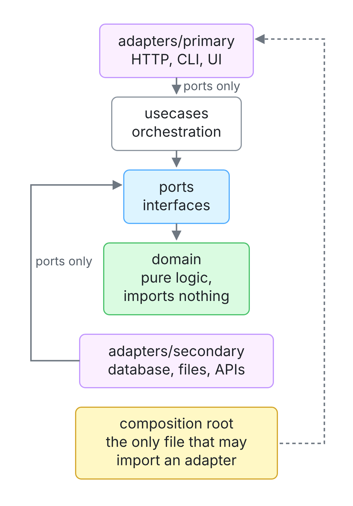
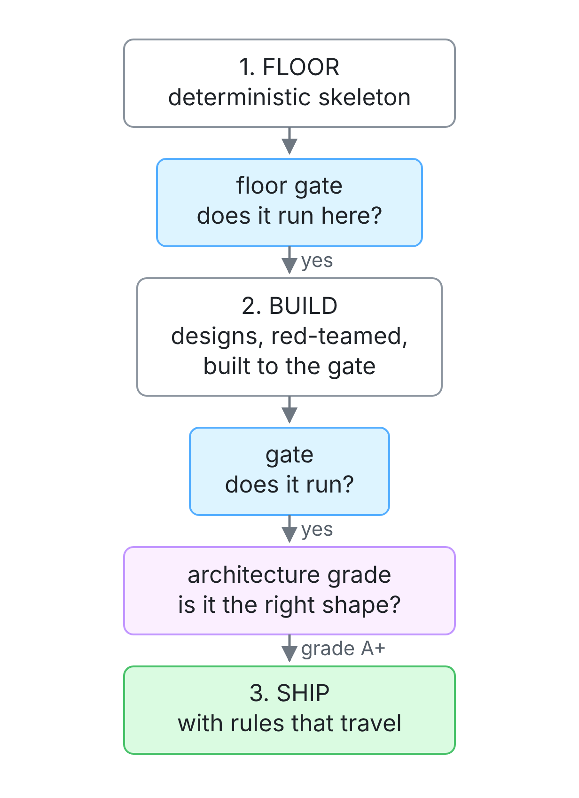

Generating code stopped being the bottleneck. Checking it didn't.

An AI agent produces a working feature in minutes. It also produces features whose tests pass and whose shape is wrong. A use case imports a database driver. A domain type depends on an HTTP client. Nothing fails. The suite is green. The next change is a little harder, and the one after that is harder still.

A test suite answers one question: *does it run?* Nothing in the usual loop answers the second one: *is it still the system I designed?* In [Inside the AI Harness](/2026/10/inside-the-ai-harness/) I argued that the checks, not the prompts, are what let you trust an agent's work. This post is about a check for design itself, and the tool I built to run it.

## The shape that rots first

Architecture rarely fails in one dramatic commit. It erodes one reasonable-looking import at a time. A human team slows that erosion with code review and shared memory of why things are where they are. An agent has neither. It optimizes for the thing you can measure, and in most projects the only thing you can measure is whether the tests pass.

So the agent takes the shortest path to green. If the shortest path runs through a database driver imported straight into business logic, that is the path it takes, and nothing objects. Multiply that by every feature and you get a codebase that works today and resists every change tomorrow.

You cannot fix this by asking more politely. "Keep a clean separation of concerns" is a wish, and the genie grants the letter of it. You need a rule that can fail.

## Ports and adapters, briefly

Hexagonal architecture, which Alistair Cockburn named *ports and adapters*, puts the business logic at the center and pushes everything that touches the outside world to the edges.

- **The domain** holds the rules of the business: pure logic that imports nothing outside itself.
- **Ports** are the interfaces the core uses to talk to the world: "store a bookmark", "send a notification".
- **Use cases** orchestrate the domain through ports.
- **Adapters** implement those ports for real technology: an HTTP handler on the way in, a SQLite store on the way out.
- **A composition root** is the one place that wires real adapters into the core.



*Every dependency points inward*

The point is not the hexagon. The point is that every dependency points inward. The core never knows which database it is using, so you can swap the database by changing one file.

## Why this shape suits AI-written code

Lots of architectures are good. Hexagonal has a property that matters more when an agent is writing the code: **its rules are mechanically checkable.** "Good separation of concerns" cannot be graded. This can:

| # | Rule |
|---|---|
| 1 | `domain/` imports only `domain/` |
| 2 | `ports/` imports `domain/` only |
| 3 | `usecases/` imports `domain/` and `ports/` only |
| 4 | adapters import `ports/` only, never the domain directly |
| 5 | adapters never import other adapters |
| 6 | only a composition root imports an adapter |

Each rule is a statement about the import graph, and an import graph is something a tool can walk. A style rule tells you a line is ugly. These tell you a *dependency* is wrong, which is the thing that makes a codebase expensive to change. And because it is a graph property rather than a matter of taste, a number falls out of it. That number is what lets architecture be a gate instead of a suggestion.

Rule 4 is the one implementations break. An adapter that needs a domain type gets it because the **port re-exports it**, so every adapter has exactly one edge into the core. That single edge is what makes the swap-one-file promise true.

## hexa: two gates, not a spec

[hexa](https://github.com/gaberger/hexa) is the tool I built around that idea. It scaffolds Rust, Go and TypeScript projects in the ports-and-adapters style, has an AI agent write the code, and lets two gates decide whether the result counts:

1. **A command that must exit 0.** Your tests, your build: *does it run?*
2. **An architecture grade that must hold.** `hexa analyze` walks the syntax tree of every file, checks every import against the rules, and produces a grade: *is it the shape you asked for?*



*The two gates*

A few design choices follow from taking those gates seriously.

**The floor is not generated.** The project skeleton comes from templates compiled into the binary, byte-identical on every machine, and its gate runs before any model is called. A scaffold you cannot reproduce is not a foundation; it is a draft.

**The rules travel with the project.** Every scaffold ships its rules file, and `hexa analyze` keeps grading against it after the first commit. The scaffold is not a starting point you leave behind. It is the contract the project keeps being measured against.

**The grade claims no more than it saw.** A file with no layer cannot be checked, so the score is capped at the share of files that have one. An A+ needs all of them.

**There is no spec step.** This was the most counterintuitive decision, and the one I am most sure of. The popular answer to agents drifting is to write the spec first. But **a spec is prose, and prose cannot fail.** Code drifts from a spec in silence, because nothing ever runs the spec. hexa's own decision records proved it: an audit found 140 decision IDs cited across the code and docs, and 113 of them pointed to no file at all. The most-cited decision, referenced 39 times, did not exist. Nothing raised an error, because nothing checked. A gate is a command, so it goes red the moment it stops being true.

## Why static languages

hexa scaffolds Rust, Go and TypeScript rather than dynamic languages like Python for the same reason: **a compiler is a gate.** In a statically typed language a wrong shape fails in seconds, before any test runs. The import graph is also only knowable when imports are explicit and resolvable at build time; runtime module loading makes the boundaries invisible to any tool, and then the second gate cannot exist.

The strictness has a cost, and it shows up in which models can pass. On the same task, the best local model passed Rust 5 of 5 times, while two others that passed some TypeScript runs passed Rust 0 of 5. The local model at the top of a public coding leaderboard scored last in this loop. That is a gate doing its job, and a reason to measure models on your own work rather than trust a leaderboard.

## What the gates caught

Every claim in hexa's README has a command that re-derives it. A few results:

- **Tests that can fail.** Six example projects were each built from a single sentence. In the one with real HTTP and SQLite, breaking the status code failed 4 tests, breaking a domain rule failed 3 more, and restoring the code returned 27 of 27. A passing test proves nothing until you have watched it fail.
- **The boundary held under pressure.** With a live database and a live listener, the tempting shortcut is a use case reaching for the driver. The use cases imported the domain, the ports and the standard library, and nothing else.
- **A bug fourteen tests missed.** `hexa harden` runs an adversarial review: hunt for bugs by failure class, try to refute each finding, and fix only what survives, under the gate. On a rate limiter it found a comment claiming a multiplication could not overflow. It could, a cast silently truncated the result, and the limiter would limit nothing. All 14 tests passed. A spec would not have caught it either, because the intent was right.
- **Refactoring someone else's code.** Given a web client with 17 boundary violations and no ports layer, hexa was handed the rule and the count, not the files. It found all 17 plus five more, added a typed ports layer, changed no logic, edited no test, and kept all 177 tests green.

hexa also grades itself: **A+, 100 of 100**, zero boundary violations and zero cycles across its own source, with a test that fails the build on any new violation.

## What it can't do

The limits matter as much as the results.

- **It does not write the code.** A frontier model does. hexa contributes the deterministic floor, the gates, the grade and the adversary. It turns a capable model into a disciplined one; it does not replace it.
- **It sees what a static import shows.** Code generated by macros, reflection and foreign-function calls are out of its sight, and the composition root is trusted by design.
- **Some things are still hard.** Given a rule, hexa finds every file that breaks it. Given only a failing test, it found the right file once in ten tries.

## Try it

```bash
curl -fsSL https://raw.githubusercontent.com/gaberger/hexa/main/install.sh | bash
hexa bootstrap

# a scaffold gated on the build AND the grade
hexa scaffold "A bookmark service: SQLite store, HTTP API, tag search" \
  --target ./myapp --lang rust --grade A

# grade an existing project
hexa analyze .
```

## The takeaway

In the harness article I called an organization's checks a *taming asset*: the thing a competitor cannot copy in a week. Most teams have checks for behavior. Very few have a check for design, and design is what decides how much the next change costs.

Hexagonal architecture is useful for agents not because it is fashionable, but because it turns "is this still the system I designed?" into a question a machine can answer with an exit code. Once design can fail, an agent can be held to it, and you can trust a green build to mean more than "it runs."
