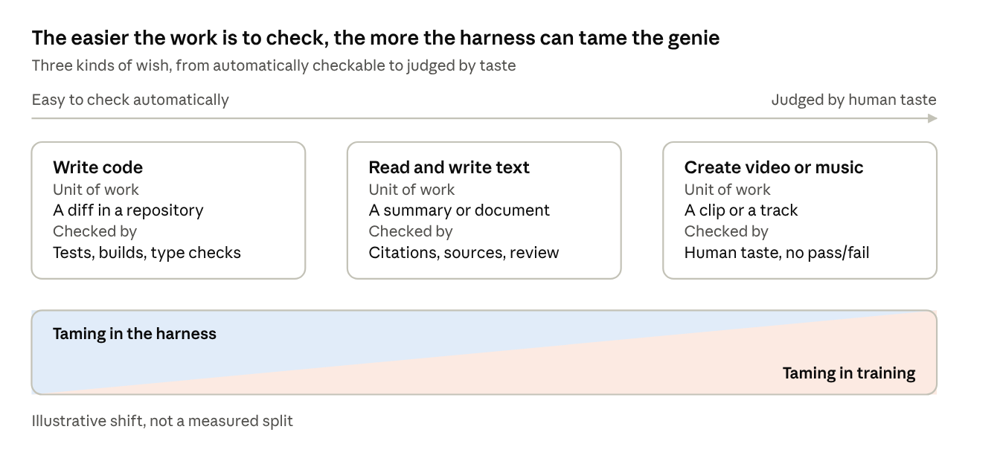
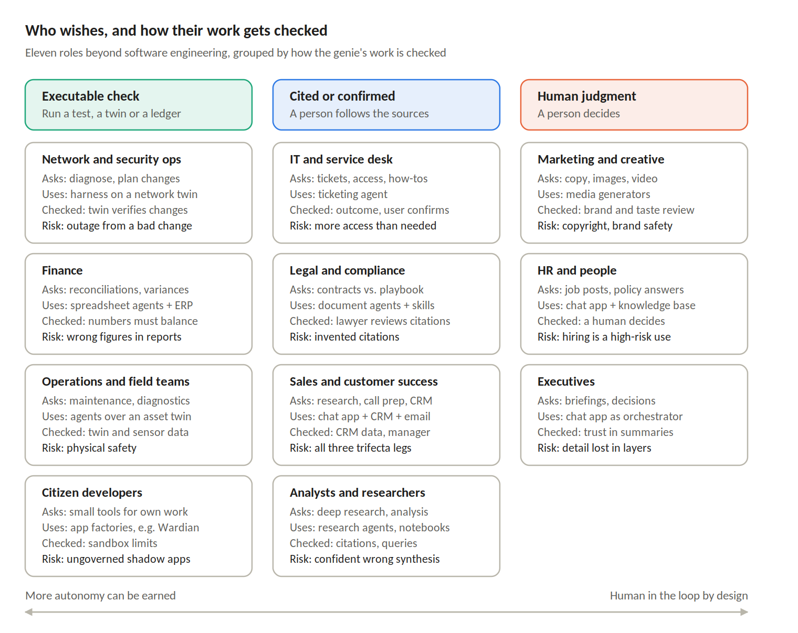
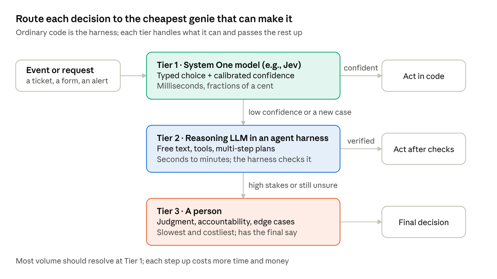
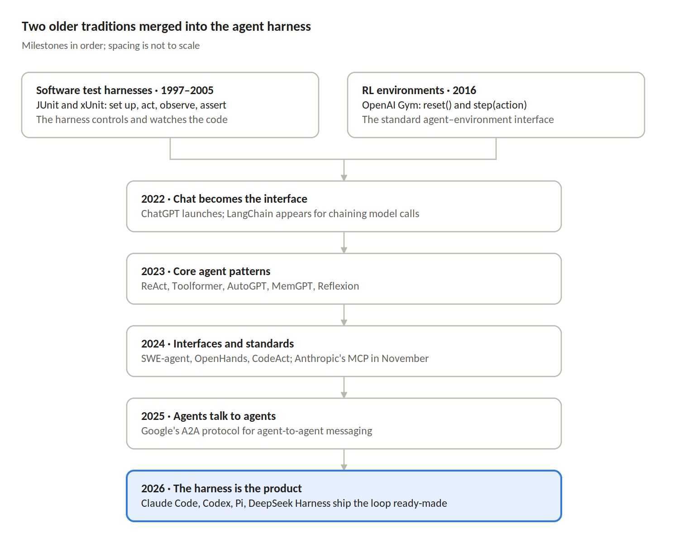
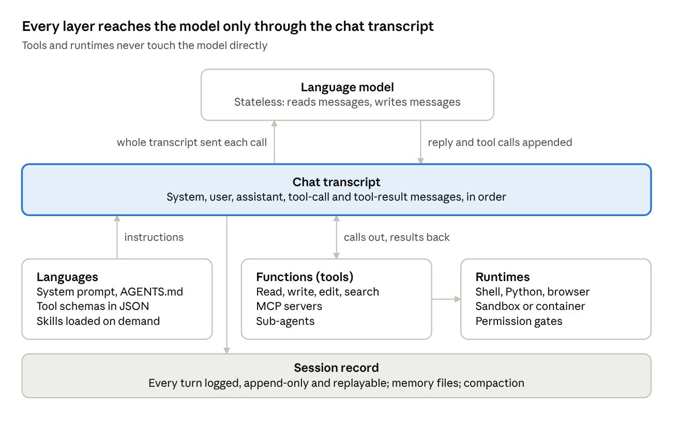
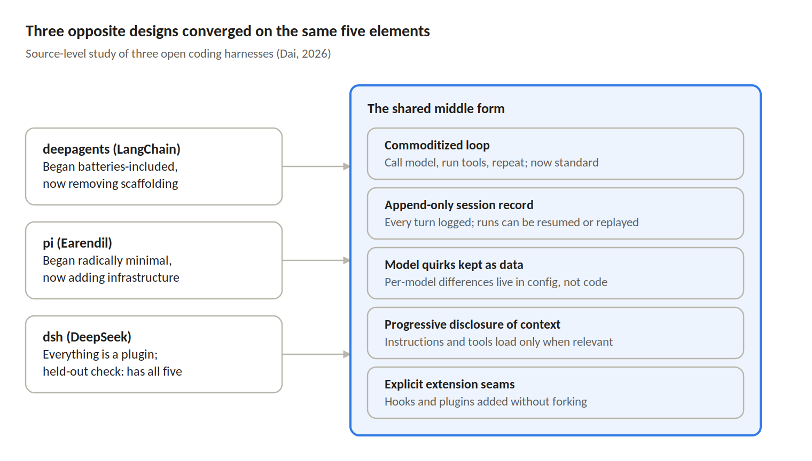
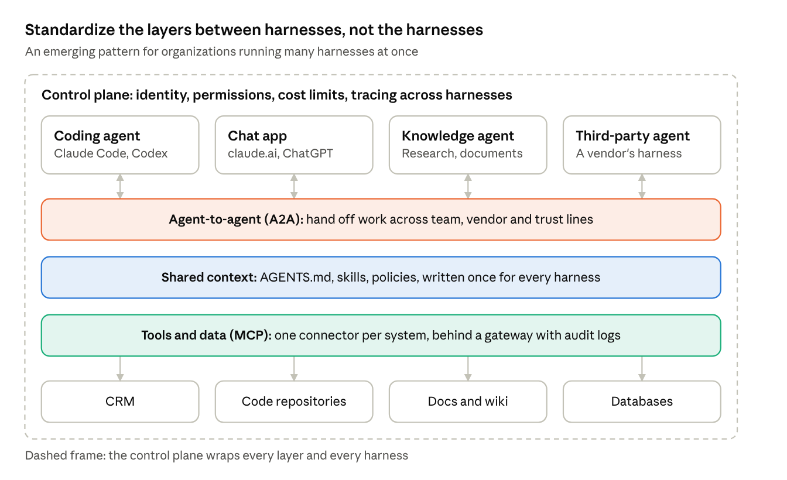
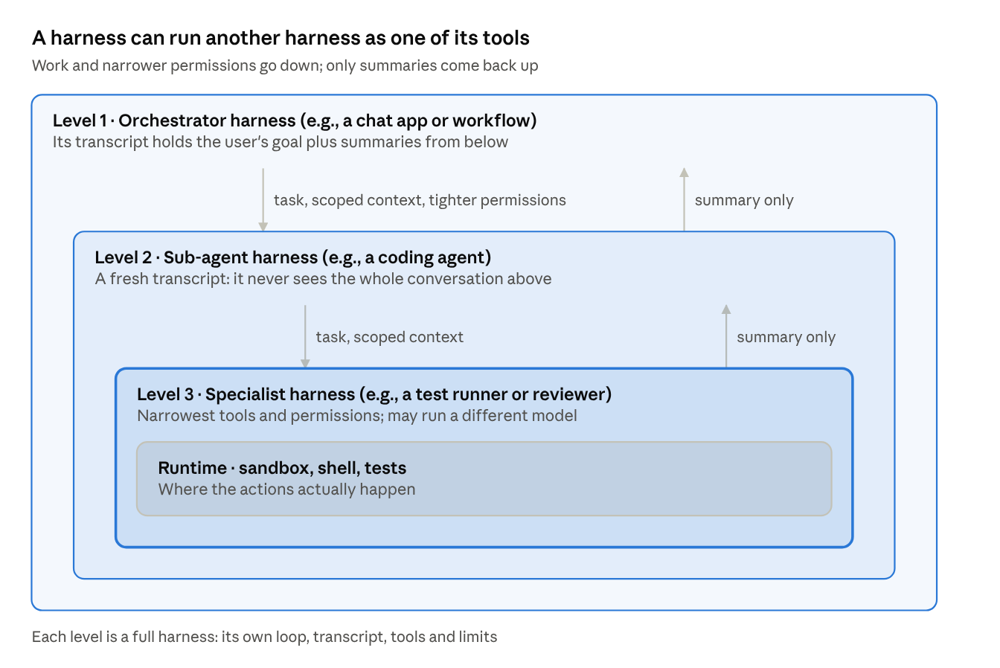
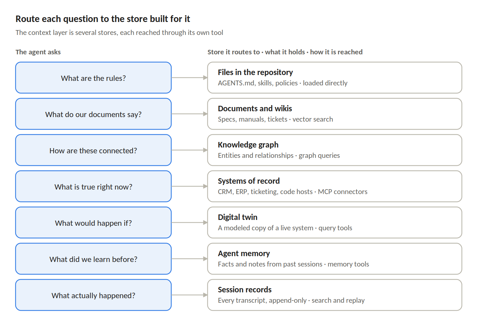
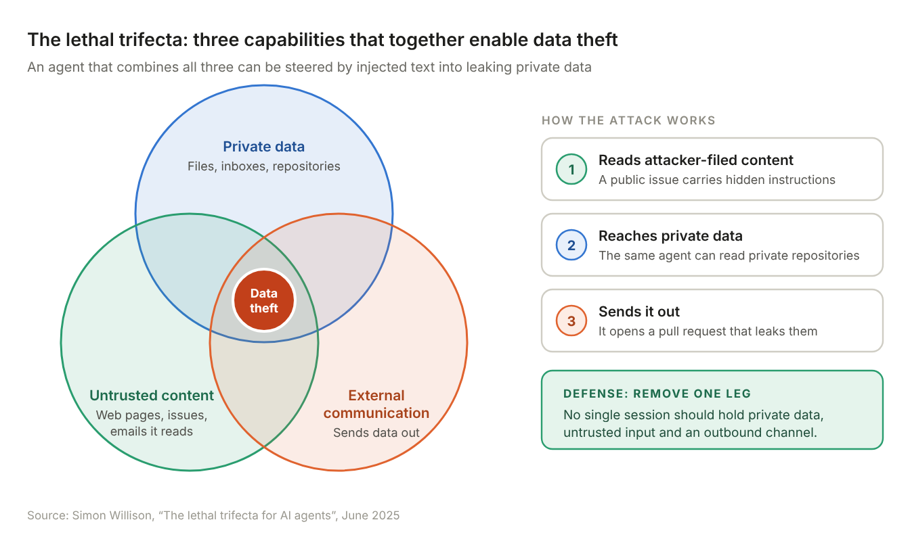

*Written by a practitioner who has spent three years building AI apps, harnesses and code development tools. See* About the author *at the end.*

## Why the harness matters

In 2026, what an AI agent can actually do depends less on the model and more on the software wrapped around it. That wrapper is the harness.

A language model on its own is a function: text in, text out. It cannot read a file, run a test, remember yesterday, or check its own work. Everything that lets it do those things lives outside the weights.

A useful working definition: **a harness is a substrate of languages, runtimes and functions, organized around the chat transcript of a language model.** The languages are how instructions and tools are described (prompts, JSON schemas, Markdown files like AGENTS.md). The runtimes are where actions execute (shells, sandboxes, browsers, interpreters). The functions are the tools the model can call. The chat transcript is the thread that ties them together.

Harnesses come in several kinds, all built from that same substrate. They differ in which tools they expose and how they check results:

- **Coding agents** (Claude Code, Codex, Pi) give the model a repository, a shell and a test suite. Results are checked by running the code.

- **Chat apps** (claude.ai, ChatGPT) are harnesses too. Web search, file uploads, memory and artifacts are all tools wired into one conversation, and the person reading is the main check.

- **Knowledge-work agents** (deep research, document and spreadsheet agents) read and write text across many sources. Citations and human review do most of the checking.

- **Media generators** (video, image, audio and music tools) wrap a model with a thin layer of prompts and controls. Quality is judged by taste.

The later section *Different wishes, different genies* looks at why these differences matter.

Recent research puts it bluntly. A 2026 survey argues the harness, not the model, is the binding constraint on how agents perform in the real world ([survey](https://www.preprints.org/manuscript/202604.0428)). This article explains what that layer is made of, why it looks the way it does, and where it is heading.

## Taming the genie

The goal of a harness is to tame the genie, and the genie itself is shaped by training, not by the harness.

Kent Beck calls the model "the genie" because, in his words, "it grants wishes, but it is not what you really wanted" ([Beck, 2025](https://videos2.itrevolution.com/watch/1122001849/)). Ask loosely and the genie grants the letter of the wish, not its intent. Learning to phrase each wish precisely is what we call prompt engineering. Beck even titled one essay [Taming the Genie](https://newsletter.kentbeck.com/p/taming-the-genie-like-kent-beck).

There is a fitting irony here. Beck co-created JUnit, the test harness the word "harness" descends from.

### From changing the weights to writing the context

The way we tame the genie moved from retraining the model to writing into its context window, and harnesses only became possible after that shift.

**Early on, taming meant fine-tuning.** To get a model to do a task, you retrained some or all of its weights on thousands of examples. In the BERT era, one lighter option froze the pretrained model and trained only a small task head on top. The standard practice, though, updated the whole network, because it usually performed better ([Wang et al., 2021](https://arxiv.org/pdf/2107.05377)).

**Then the context window became the lever.** GPT-3 showed in 2020 that a large enough model could do new tasks with no gradient updates at all. Instructions and a few examples in the prompt were enough, and larger models got better at it ([Brown et al., 2020](https://arxiv.org/abs/2005.14165)). The weights stay fixed; the words in context change which internal pathways activate. This is where prompt engineering was born.

**It took off once models could speak structure.** In June 2023 OpenAI shipped function calling: models that return JSON arguments for external tools ([OpenAI](https://www.longtermwiki.com/resources/461efab2a94bf7c5)). In August 2024, Structured Outputs made responses reliably match a developer's JSON Schema ([OpenAI](https://openai.com/index/introducing-structured-outputs-in-the-api/)).

There is a twist. Those function-calling models were themselves fine-tuned for the job. Fine-tuning did not disappear; it moved upstream to the model makers, who now train genies to follow wishes written in context. Once the genie reliably speaks JSON, its words can be wired to real functions, and that wiring is the harness.

**The genie's nature comes from training.** How a model was trained, and how large it is, decide how it tends to answer. The harness cannot add abilities the model lacks.

**And nobody can fully see inside the lamp.** Anthropic's circuit-tracing work can trace some of the steps a model takes inside to reach an answer ([MIT Technology Review](https://www.technologyreview.com/2025/03/27/1113916/anthropic-can-now-track-the-bizarre-inner-workings-of-a-large-language-model)). Anthropic itself says its attribution graphs only partially reveal those steps ([Anthropic](https://anthropic.com/research/open-source-circuit-tracing)). One commentary notes these methods explain only a single-digit percentage of the model's activity ([Morpheos](https://morpheos.substack.com/p/peeking-inside-the-ai-black-box)). MIT Technology Review named mechanistic interpretability a 2026 breakthrough, while conceding that even model builders do not fully understand how these systems work ([MIT Technology Review, 2026](https://www.technologyreview.com/2026/01/12/1130003/mechanistic-interpretability-ai-research-models-2026-breakthrough-technologies/)).

This seems to clash with the harness research later in this article. If training decides the genie's nature, the harness should matter little; yet that research argues the harness, not the model, is what limits real-world performance. Changing only one tool format reportedly took the same model from 6.7% to 68.3% on SWE-bench. The two views fit together once the roles are separated:

- **The model decides what the genie can do** and how it tends to answer.

- **The harness decides how much of that you can reliably get.** Instructions narrow the wish, tools limit what it can touch, and tests check what it actually did.

The limits of interpretability are exactly why harnesses exist. Because we cannot read the genie's mind, we constrain and verify it from the outside. The rest of this article is about how.

## Different wishes, different genies

How far a genie can be tamed depends on what you ask it for, and above all on how easily its work can be checked.

*Three kinds of wish · from checkable to judged by taste*

Code sits at the left: tests let the harness do most of the taming. Media sits at the right: with no automatic check, most of the taming happens in training.

**Code: the software factory.** Because code can be tested, it was the first genie tamed at scale. A 2026 definition describes the software factory as AI agents that write, test and ship code inside a pipeline, while humans keep control of specifications and merge approvals ([Augment Code](https://www.augmentcode.com/guides/what-is-a-software-factory)). The term is more than five decades old. It was revived in 2026 by BCG Platinion's "Agentic Software Factory" and Factory.ai's "Factory 2.0" manifesto ([TrueFoundry](https://www.truefoundry.com/fr/blog/software-factory-agentic-enterprise-guide)). StrongDM went furthest, with specifications driving agents to working software and no human code review ([StrongDM summary](https://git.bros.ninja/mike/gravity/src/branch/develop/docs/research/ai-software-development-2026-research.md)). The bottleneck has moved: agents now produce code faster than teams can verify it.

**Text: harder to verify.** A summary has no test suite. Text harnesses lean on citations, retrieval and human review. A coding harness can assume a repository and a diff as its unit of work; a knowledge-work harness has to invent its own equivalent.

**Media: taming happens in training, and so does the controversy.** With no automatic quality check, a media harness is thin. What the genie produces depends mostly on what it was trained on. Suno is the clearest example:

- **The dispute.** In 2024 the major labels sued Suno and Udio, alleging they copied hundreds of popular songs to build systems that would compete with human artists. Both companies argued that training on recordings is fair use under U.S. law ([Reuters via MarketScreener](https://uk.marketscreener.com/news/warner-music-group-settles-copyright-case-with-suno-for-licensed-ai-music-ce7d5ed2db8bff22)).

- **Settlements.** Warner settled in November 2025, and Suno agreed to replace its models with licensed ones in 2026 (same source). BMG struck a revenue-sharing deal in August 2026 ([Boston Globe](https://www.bostonglobe.com/2026/08/12/business/suno-ai-songs-bmg-deal-copyright/)).

- **Still open.** As of August 2026, Universal Music Group and Sony Music were still suing Suno, alongside separate suits from independent musicians (Boston Globe).

The outcome is unsettled, and the arguments on both sides are serious. Either way, it shows the article's central tension from another angle: in code, the harness does much of the taming; in music, how the genie was trained is the whole story.

## Beyond software engineers

Most people in an organization will meet harnesses outside software engineering, and how their work gets checked should decide how much autonomy their agents get.

*Eleven roles · what they ask, use, check and risk*

Three insights fall out of this view:

- **Autonomy should follow checkability.** Some roles can check work by running something: a test, a twin, a ledger that must balance. Others check by following citations. Others rely on human judgment. That extends the *Different wishes* spectrum from task types to job roles, and it gives a governance rule: the first group can earn more autonomy, while the third needs a human in the loop by design.

- **Most people meet harnesses through the chat app.** Non-engineers will not write AGENTS.md files or wire MCP servers. Administrators package skills, plugins and connectors for them. These users inherit whatever taming the organization built, which makes the shared context layer and the control plane matter even more.

- **Digital twins extend executable checking beyond code.** A network twin lets an agent's proposed change be verified before it touches production, much as tests verify code. Finance has its ledger and operations its plant model. Any role that gets an accurate, queryable model of its world moves toward the easy-to-tame end of the spectrum.

## The genie keeps changing shape

The genie is evolving fast, and three newer ideas, world models, system-level AI and tiered decision models, suggest it will not stay a chat-only text predictor for long.

**World models: a genie that predicts the world, not the next word.** A language model predicts the next piece of text. A world model predicts how an environment changes when something acts in it. Yann LeCun, who left Meta in December 2025 to found AMI Labs, argues this is the path past language models. He describes a world model as your mental model of how the world behaves ([Introl](https://introl.com/blog/world-models-race-agi-2026)). AMI Labs builds on his JEPA research, which learns abstract representations instead of generating every pixel ([AI Weekly](https://aiweekly.co/learning-ai/deep-learning/world-models-ai)).

Google DeepMind takes the generative route. Its model, fittingly named **Genie 3**, simulates interactive 3D worlds in real time; DeepMind calls it the first real-time interactive general-purpose world model ([Introl](https://introl.com/blog/world-models-race-agi-2026)). Fei-Fei Li's World Labs is a third major player.

For harnesses, this matters because a world model's "transcript" is no longer just text. An agent that can predict the results of its actions can plan before it acts, and its harness will need to check plans against physics and environments, not just test suites.

**System-level AI: the genie as a team, not a soloist.** In 2024, Berkeley researchers argued that the best AI results increasingly come from compound AI systems. They define these as systems that tackle AI tasks using multiple interacting components, including models, retrievers and tools ([BAIR](https://bair.berkeley.edu/blog/2024/02/18/compound-ai-systems/)). Their point was that leading results can come from clever engineering, not just bigger training runs.

A modern harness is exactly such a system: one or more models, plus retrieval, tools, sub-agents and checks, coordinated through a transcript. The "genie" a user meets is increasingly the whole system, not a single model.

**Tiered models: a genie that only answers in typed choices.** A third shift splits the genie into tiers by speed and cost. In 2026 TypeSafe AI, founded by a former OpenAI researcher, launched what it calls the first "System One Model," named after Daniel Kahneman's fast, intuitive System 1 thinking ([TypeSafe AI](https://typesafe.ai/blog/introducing-system-one-models-and-jev)). Its first model, Jev, gives up free text entirely. Developers define the possible outputs in advance, and the model returns a typed choice with a calibrated confidence score. TypeSafe describes it as unstructured state in and typed probabilistic decisions out, a frontier-intelligence function call.

This inverts the harness. With a chat model, the harness wraps around the genie and turns its free text into actions. With a System One model, ordinary code is the harness and the model is a function inside it, a "smart if-statement" that classifies, routes, scores or extracts. In genie terms, it can only answer multiple choice: it can still pick the wrong option, but it cannot grant a wish in a form nobody asked for.

*Tiered models · decision model, reasoning LLM, person*

Tiers change how taming works:

- **Confidence becomes a check.** Code can act alone on high-confidence decisions and send the rest up a tier. TypeSafe's argument is that a model which succeeds 95% of the time but cannot say when it is in the other 5% cannot automate a task.

- **Autonomy follows checkability, per decision.** The *Beyond software engineers* rule applies at a finer grain: routine, confident choices resolve in code, and hard or high-stakes ones reach a reasoning model or a person.

- **Fast models make good guardrails.** TypeSafe lists scoring, judging and jailbreak detection over other models' prompts and outputs among Jev's uses, which fits the specialist levels in *Harnesses inside harnesses*.

- **Cheaper decisions mean more of them.** Jev is named after economist William Stanley Jevons, whose paradox held that more efficient coal use raised total demand. TypeSafe expects the same as the cost of intelligence falls.

Caveats apply. Jev is in early access, and the speed and cost figures are TypeSafe's own. Its workflow benchmark scores Jev against the average answers of two frontier models rather than ground truth, a limitation TypeSafe notes. And "can't hallucinate" means it cannot return an invalid type or an option outside the list; it can still choose the wrong one.

**What this means for taming.** All three trends point the same way. The model inside the lamp keeps changing, and the lamp is becoming a system of several genies. Harnesses that keep the model swappable and the checks independent of any one model, like the convergence pattern described below, are best placed to survive that change.

## Where the word comes from

The term "harness" was borrowed from two older traditions, and both still shape how agent harnesses work.

The first is the **software test harness**. JUnit and the xUnit family standardized a fixed lifecycle: set up, act, observe, assert. The harness owned the environment; the code under test just ran inside it. The second is the **reinforcement learning environment**. OpenAI Gym (2016) made reset() and step(action) the canonical interface between an agent and its world.

Agent harnesses merge the two. Like a test harness, they control and observe an unpredictable process. Like an RL environment, they hand the model an observation, take its action, and return the result.

*Harness lineage · two roots, five steps to 2026*

Milestones from the survey's timeline ([Awesome-Agent-Harness](https://github.com/Gloriaameng/Awesome-Agent-Harness)).

The shift in vocabulary from "framework" to "harness" is itself telling. A framework is a kit you assemble. A harness ships with the loop already running, and you configure it.

## Anatomy of the substrate

Every part of a harness exists to do one of two things: put the right words into the transcript, or act on the words the model writes there.

*Harness anatomy · model, transcript, three layers, session record*

Languages and functions feed the transcript; runtimes are reached only through function calls; the session record keeps everything.

- **The loop.** Call the model. If it asked for tools, run them, append the results, and call again. Stop on a final answer, a turn limit, a cost limit or a human interrupt. A working version fits in a few dozen lines.

- **Languages.** Three kinds of language describe the agent's world: natural language (system prompts, project files like AGENTS.md), schema language (JSON Schema for each tool's inputs), and the programming languages the tools themselves are written in.

- **Functions.** Each tool is a name, a description and an input schema. MCP lets a harness load tools from external servers through a config file rather than new code. A sub-agent is just a function that runs a second loop with a clean context and returns a summary.

- **Runtimes.** This is where actions actually happen: shells, interpreters, browsers. Serious harnesses put them behind a sandbox (a container or a disposable micro-VM) and behind permission prompts.

- **Context management.** The harness decides what enters each request: it compacts old turns, truncates large tool output, and loads skills only when a task needs them.

- **State.** An append-only session log, plus plans, to-do lists and memory files written to disk, so work can survive a crash or a new session.

- **Extension seams.** Hooks that fire before and after tool calls, plugins, and config files let teams add policy, logging and new tools without forking the harness.

The survey formalizes nearly the same parts as six components: execution loop, tool registry, context manager, state store, lifecycle hooks and an evaluation interface ([survey repository](https://github.com/Gloriaameng/Awesome-Agent-Harness)).

## Why everything orbits the chat transcript

The chat transcript is the harness's only channel into the model. Every layer of the substrate, however exotic, eventually has to become messages in that transcript.

Modern model APIs expose a conversation as a list of typed messages. A system message carries standing instructions. User messages carry requests. Assistant messages carry the model's text and its tool calls. Tool-result messages carry what happened when those calls ran. That is the whole interface.

This has three consequences that explain a lot of harness design:

- **The transcript is the bus.** A shell command, a file read, a web search and a sub-agent's report all come back the same way: as a tool-result message. The model never touches the runtime directly; it only reads what the harness writes into the conversation.

- **The transcript is the state.** The model is stateless between calls. Whatever the harness puts in the next request is, for the model, everything that has ever happened. Memory, plans and progress notes exist only if the harness serializes them back into context.

- **The transcript is the budget.** Context windows are finite and every token costs money and attention. So a large share of harness engineering is deciding what to leave out: compacting old turns, loading instructions only when relevant, and truncating noisy tool output.

This is why "context engineering" became a core skill for agent builders. The harness is, in large part, an editor of the transcript: it decides what the model sees, in what order, and in what words.

## Different philosophies, same shape

Harnesses built on opposite design philosophies are converging on the same five architectural elements.

An August 2026 source-level study read three open coding harnesses at pinned commits ([Dai, 2026](https://tldr.takara.ai/p/2608.23953)). LangChain's deepagents started batteries-included and has been removing scaffolding. Earendil's pi started radically minimal and has been adding durable infrastructure. DeepSeek's dsh treats everything as a plugin. All three ended up in roughly the same middle form:

*Harness convergence · three designs, five shared elements*

The author is careful about causes. Some of this is parallel discovery, some is ideas spreading between projects, and in one case a harness reuses another's code directly.

The convergence makes sense once you see the transcript as the center. If the loop is just "append to the transcript and call the model," there is little left to innovate in the loop itself. The interesting work moves to what goes into the transcript, and how that record is kept.

## The 2026 landscape: four bets

Today's popular harnesses share the same loop but bet on different answers to one question: what makes an agent reliable over a long session?

| Harness                                                                   | Built by                       | Design bet                                                                                   | Guards against                          |
|---------------------------------------------------------------------------|--------------------------------|----------------------------------------------------------------------------------------------|-----------------------------------------|
| Claude Code                                                               | Anthropic                      | A few fixed mechanisms done well: planning, sandboxed files, sub-agents, context compression | Long sessions drifting off track        |
| [Deep Agents](https://www.langchain.com/deep-agents)                      | LangChain                      | The same four mechanisms as an open, model-agnostic library                                  | Drift, plus lock-in to one model        |
| [DeepSeek Harness](https://github.com/deepseek-ai/deepseek-harness) (dsh) | DeepSeek                       | Everything is a plugin: model, sandbox, session store, loop and UI swap at runtime           | Architectural lock-in                   |
| [Hermes Agent](https://github.com/nousresearch/hermes-agent)              | Nous Research                  | Compounding memory: solved tasks become reusable skills across sessions                      | Redoing the same work                   |
| [Pi](https://github.com/earendil-works/pi)                                | Mario Zechner / Earendil       | Minimalism: four built-in tools, everything else an opt-in extension                         | Bloat and a large audit surface         |
| [OpenHands](https://docs.openhands.dev/openhands/usage/sandboxes/docker)  | All Hands AI                   | A dockerized engineer with shell, browser and tests built in                                 | Agent actions touching the host machine |
| Aider                                                                     | Paul Gauthier and contributors | Git-native: every agent step is a reviewable commit                                          | Changes too large to review             |
| Cline                                                                     | Cline Bot Inc.                 | Approval-gated: every edit and command waits for sign-off                                    | Actions nobody approved                 |

Compiled from each project's public documentation and published comparisons, as of September 2026.

Two data points show how much these choices matter. Changing only a harness's edit-tool format reportedly took one model from 6.7% to 68.3% on SWE-bench. Vercel found that removing 80% of its agent's tools helped more than a model upgrade. Both are collected in the [survey repository](https://github.com/Gloriaameng/Awesome-Agent-Harness).

## Harness stacking: when many genies share one house

Organizations will not run one harness; they will run many, and without shared layers between them, teams step on each other.

Engineers use a coding agent. Staff use a chat app. Analysts use a research agent, and vendors bring their own. Left alone, each harness gets its own copy of the company's rules, its own connection to the CRM, and its own permissions. The result is duplicated connectors, conflicting instructions, agents with more access than anyone intended, and no single record of who did what.

*Harness stacking · four harnesses, three shared layers, one control plane*

The harnesses on top will keep changing. The layers beneath them are what the organization should own.

**Is A2A the answer, or MCP?** Neither alone, because they solve different problems. MCP connects an agent to tools and data; A2A connects agents to each other ([MintMCP](https://www.mintmcp.com/blog/a2a-vs-mcp)). MCP answers "what can this agent touch?" A2A answers "who can this agent hand work to?" Both now have broad backing. MCP moved to neutral governance in December 2025, when the Linux Foundation formed the Agentic AI Foundation around MCP, Block's goose and OpenAI's AGENTS.md ([WorkOS](https://workos.com/blog/the-linux-foundation-launches-the-aaif)). A2A is backed by more than 150 organizations, according to a vendor summary of Linux Foundation figures (MintMCP).

**Our insight: standardize the layers between harnesses, not the harnesses.** Four layers do the work:

1.  **Shared context: write the wish once.** Company rules, conventions and know-how live in portable files, such as AGENTS.md and skills, that every harness loads. This is the cheapest layer and the most often skipped. Without it, each harness is tamed separately, and each genie hears a slightly different wish.

2.  **Tools and data (MCP): one connector per system.** Build each connector once and route every harness through a gateway that handles sign-in, permissions and audit logs.

3.  **Agent-to-agent (A2A): only across real boundaries.** Use it where work crosses a team, vendor or trust line, such as a support agent handing a refund to finance's agent. Inside one harness, sub-agents are simpler and cheaper.

4.  **Control plane: the harness of harnesses.** Every agent gets an identity, permissions, cost limits and a trace that follows a task across harnesses. This layer is the least mature, and it is where the provenance gap bites hardest.

Two rules of thumb follow:

- **Keep stacks shallow.** Every hop between harnesses adds cost, delay and another chance for the wish to be misread. The genie problem compounds with each handoff.

- **Use the simplest stacking that works.** A whole agent can be exposed as an MCP tool of another harness. That is often enough before A2A's long-running tasks and negotiation are needed.

A caveat: most writing on this comes from vendors selling gateways, and practice is still forming. Treat this as an emerging architecture, not a settled one.

### Harnesses inside harnesses

Harnesses also stack vertically: a harness can call another harness as one of its tools, and that harness can call another.

*Recursive harnesses · three nested levels around one runtime*

Each level is a complete harness, with its own loop, transcript, tools and limits. The level above sends down a task, the context it needs and narrower permissions. Only a summary comes back up, so the orchestrator's transcript stays small.

**Why build this way:**

- **Clean context.** Each genie sees only what its job needs, so long sessions drift less.

- **Least privilege.** A test runner needs a sandbox, not the CRM. Each level can hold fewer trifecta legs than the one above.

- **Specialization.** A lower level can use a cheaper or more specialized model, or a different harness entirely.

- **Parallel work.** Several sub-harnesses can run at once, in separate worktrees or sandboxes.

**What it costs:**

- **The wish is retold at every level.** Each sub-harness is a new genie reading a new wish, written by another genie. Misreadings compound with depth.

- **Summaries lose detail.** The level above trusts a report it cannot inspect.

- **Tracing gets harder.** Knowing what actually happened means following one task through several transcripts.

- **Cost multiplies.** Every level pays for its own model calls.

The practical rule: keep depth to two or three levels, and pass down checks, not just instructions. A command that must pass is harder to misread than a paragraph of prose. The author's [hexa](https://github.com/gaberger/hexa) applies this directly: every task carries a gate that must exit cleanly, and a code-writing subagent must run in its own git worktree.

### Where the context layer lives

"Shared context" is not one store but several, each suited to a different kind of knowledge.

*Context layer · seven questions routed to seven stores*

Three patterns are emerging around these stores:

- **Route by question type.** Rules come from files, "what does it say" from vector search, "how is it connected" from a graph, and "what is true now" from a system of record or a digital twin.

- **Combine vector and graph search.** A common approach uses vector search to find the right entry points in a large knowledge graph, then follows its relationships ([Machine Learning Mastery](https://machinelearningmastery.com/vector-databases-vs-graph-rag-for-agent-memory-when-to-use-which/)). Long-term memory is often split the same way, between vector stores for similarity and structured stores for the agent's model of the world ([Redis](https://redis.io/blog/knowledge-graph-rag-structured-retrieval-ai-agents)).

- **Treat context as governed data.** Retrieval must respect who is asking, not just what was asked. Stale context misleads as badly as wrong context. And every fact an agent acts on should be traceable to its source, which is where graphs earn their keep as auditable memory.

The insight for organizations: the context layer is where taming happens at scale. A wish written once in the right store, with the right permissions, reaches every genie in every harness.

## Security and governance: who holds the lamp?

A harness gives the genie real hands, such as files, shells and inboxes, so security and governance have to live in the harness, not in the prompt.

### Security: the genie cannot tell a wish from a trap

**Prompt injection is the core problem.** Everything the model reads lands in the same transcript: the user's request, a web page, a GitHub issue, an email. The model cannot reliably tell instructions from data. Simon Willison coined the term prompt injection for this mixing of trusted and untrusted content, naming it after SQL injection ([Willison, 2025](https://simonwillison.net/2025/Jun/16/the-lethal-trifecta/)). A system prompt that says "ignore injected instructions" is just more text in the same transcript, so it can be overridden.

*Lethal trifecta · three capabilities that together enable data theft*

Willison's "lethal trifecta" turns this into a design rule. An agent that combines private data, untrusted content and a way to communicate externally can be tricked into sending your data to an attacker. His canonical example is a GitHub MCP exploit: one server could read attacker-filed public issues, access private repositories, and open pull requests that leaked the private data ([PolicyLayer](https://policylayer.com/glossary/lethal-trifecta)). The practical question becomes "which leg can I remove from this agent?", not "will the model resist?"

**The wider risk list.** The OWASP Top 10 for Agentic Applications, published December 9, 2025 by more than 100 contributors, is now the main reference ([OWASP](https://genai.owasp.org/resource/owasp-top-10-for-agentic-applications-for-2026)). Its ten categories cover goal hijacking, tool misuse, identity and privilege, supply chain, code execution, memory poisoning, inter-agent communication, cascading failures, misplaced human trust, and rogue agents ([Modulos summary](https://docs.modulos.ai/frameworks/owasp-top-10-agentic)). Sandboxes are not a full answer either: SandboxEscapeBench reports frontier models escaping containers 15–35% of the time ([survey repository](https://github.com/Gloriaameng/Awesome-Agent-Harness)).

**Controls that belong in the harness:**

- **Least privilege per agent.** Give each agent its own identity and only the tools its job needs. Split risky work so no single session holds all three trifecta legs.

- **Sandbox by default.** Run code and shell commands in a container or micro-VM, with network access off unless needed.

- **Human approval for irreversible actions.** Payments, deletions, external messages and production deploys wait for a person.

- **Treat tools and skills as supply chain.** Vet MCP servers, plugins and skill files the way you vet software dependencies; a malicious tool description is an injection too.

- **Log everything.** The append-only session record is also the security audit trail.

### Governance: deciding who may rub the lamp

Governance answers organizational questions that security tools cannot: which agents exist, who owns each one, what each may do, and who signs off.

- **Inventory first.** You cannot govern agents you cannot see. Keep a register of every harness, agent, connector and owner, including vendor agents.

- **Tiered autonomy.** Match freedom to risk: read-only agents can run freely, agents that change records need review, and agents that move money or talk to customers need approval steps.

- **Evaluate before rollout.** Test agents on your own tasks, including injection attempts, before widening their access.

- **Own the control plane.** The harness-stacking control plane described above is where these policies are enforced and recorded.

**Regulation is arriving, on a moving timeline.** In the EU, obligations for general-purpose AI model providers have applied since August 2, 2025. The Digital Omnibus entered into force on July 27, 2026 and deferred high-risk system obligations to December 2, 2027 for stand-alone systems and August 2, 2028 for AI embedded in products ([CASRAI](https://www.casrai.org/news/eu-ai-act-digital-omnibus-deadline-delay)). Transparency obligations under Article 50 were largely unaffected ([Gibson Dunn](https://www.gibsondunn.com/eu-ai-act-omnibus-agreement-postponed-high-risk-deadlines-and-other-key-changes/)). Agents used in areas like hiring, credit or education are likely to fall into high-risk categories. Organizations should check their own obligations with legal counsel.

**The wider policy map.** Binding laws mostly regulate AI systems and uses in general. The agent-specific work is newer, voluntary and still being drafted. A snapshot as of October 2026:

| Framework                                                                                                                                                                | Jurisdiction or body      | Type                              | Status, October 2026                                                                            |
|--------------------------------------------------------------------------------------------------------------------------------------------------------------------------|---------------------------|-----------------------------------|-------------------------------------------------------------------------------------------------|
| [EU AI Act](https://www.casrai.org/news/eu-ai-act-digital-omnibus-deadline-delay)                                                                                        | European Union            | Law                               | Model-provider rules since Aug 2, 2025; high-risk rules deferred to Dec 2, 2027 and Aug 2, 2028 |
| [Transparency in Frontier AI Act](https://aiagentstore.ai/ai-agent-news/topic/legal-regulatory/2026-02-03/detailed)                                                      | California                | Law                               | In effect since Jan 1, 2026; covers large frontier models                                       |
| [State AI laws](https://aiagentstore.ai/ai-agent-news/topic/legal-regulatory/2026-01-27/detailed)                                                                        | Illinois, Texas, Colorado | Law                               | Taking effect during 2026; workplace and consumer uses                                          |
| [AI Basic Act; AI Law](https://timewell.jp/en/columns/singapore-agentic-ai-governance-framework-imda)                                                                    | South Korea; Vietnam      | Law                               | Reported to take effect in 2026                                                                 |
| [AI Litigation Task Force](https://aiagentstore.ai/ai-agent-news/topic/legal-regulatory/2026-02-03/detailed)                                                             | US Department of Justice  | Federal enforcement               | Formed Jan 9, 2026 to challenge state AI laws                                                   |
| [Model AI Governance Framework for Agentic AI](https://cm.twobirds.com/en/insights/2026/singapore/singapore-introduces-new-model-ai-governance-framework-for-agentic-ai) | Singapore (IMDA)          | Voluntary, agent-specific         | Published Jan 22, 2026; a living document mapped to ISO 42001, NIST and the EU AI Act           |
| [AI Agent Standards Initiative](https://www.nist.gov/caisi/ai-agent-standards-initiative)                                                                                | NIST CAISI, United States | Voluntary, agent-specific         | Launched Feb 17, 2026; identity draft builds on OAuth 2.0, SPIFFE and MCP; nothing final        |
| [OWASP Top 10 for Agentic Applications](https://genai.owasp.org/resource/owasp-top-10-for-agentic-applications-for-2026)                                                 | OWASP                     | Security taxonomy, agent-specific | Published Dec 9, 2025                                                                           |
| ISO/IEC 42001                                                                                                                                                            | ISO and IEC               | Certifiable standard              | Baseline for AI management systems                                                              |
| NIST AI Risk Management Framework                                                                                                                                        | NIST                      | Voluntary framework               | Widely used governance baseline                                                                 |

The US picture is contested: supporters of federal action want to avoid a patchwork of state rules, while critics say it weakens protections. Expect it to keep shifting.

**Our insight: compliance is becoming a property of the harness.** Across all of these, agent governance converges on the same few controls: an identity for every agent, scoped permissions, an audit trail, and meaningful human oversight. Those are exactly the jobs of the control plane described in *Harness stacking*. NIST is even prototyping agent identity on top of MCP ([CSA summary](https://labs.cloudsecurityalliance.org/research/csa-research-note-nist-ai-agent-red-teaming-standards-202603/)). An organization that builds those controls into its harnesses will be ready for most of these frameworks at once. This table is a snapshot, not legal guidance.

Governance is where the article's threads meet. We cannot read the genie's mind, the wish can be hijacked by anything it reads, and every handoff between harnesses adds risk. The harness is how an organization proves it stayed in control.

## What's still unsolved

The loop is solved; four harder problems sit around it.

**Evaluation.** If the harness shapes results this much, benchmark scores measure a model-plus-harness pair, not a model. The Holistic Agent Leaderboard found that standardizing the evaluation harness removed bugs that earlier work had blamed on models. METR reports that benchmark-passing pull requests are merged by humans 24.2 percentage points less often than benchmark scores imply ([survey repository](https://github.com/Gloriaameng/Awesome-Agent-Harness)).

**Security.** A harness gives a model a shell, a filesystem and a network on purpose, so classic sandboxing does not map cleanly. The section above covers today's defenses. The deepest open problem remains: no model can yet reliably separate instructions from data, so prompt injection has no complete fix.

**Provenance.** The convergence study found one thing no harness has: a tamper-evident record an outside party can verify without trusting the runtime ([Dai, 2026](https://tldr.takara.ai/p/2608.23953)). Append-only logs exist, but they are trusted, not proven. The author predicts this will be the next point of divergence, especially in regulated domains.

**Harness–model coupling.** Models are increasingly trained inside specific harnesses, and AgencyBench finds agents perform best on their native harness. That raises questions about portability: will a skill file, tool or memory store work in a different harness, with a different model, next year?

## The next inflection point: when code is cheap, what's left?

The software factory is starting to point outward, at other companies' products, and that shifts where value lives.

In October 2026, a four-person team released ArtCraft, a free, open-source suite of creative apps closely modeled on Adobe's tools ([Futurism](https://futurism.com/future-society/adobe-creative-suite-software-open-source-artcraft)). According to co-founder Michael Caffrey, the team built it by reverse-engineering Adobe's top seven tools with Claude 5.5. Until now, the software factory meant teams building their own software faster. Here a small team with a harness set out to recreate a suite that took a large company decades.

If that pattern holds, copying software features is becoming cheap, and value moves to what is harder to copy:

- **Verification.** Matching features is cheap; being polished, stable and trustworthy is not. Early users made the same point: AI speeds up prototypes, but prototypes are not finished products. Generating code stopped being the bottleneck; checking it did not.

- **The context layer.** Data, workflows, integrations and accumulated know-how are much harder to clone than code.

- **Trust and governance.** Organizations will see a wave of AI-built alternatives to the tools they rely on. Vetting them as supply chain, as described in *Security and governance*, becomes a much larger job.

Caveats apply. ArtCraft is in active development, with some apps in early alpha, so professionals are unlikely to switch yet. The account comes mostly from the founder, and the coverage is openly critical of Adobe, whose view is not represented. Reverse engineering commercial software also raises open questions about license terms and copyright, which courts and vendors will settle case by case.

The direction is still clear. When the genie can rebuild software on request, the scarce things are the wish worth making, the checks that prove it was granted, and the context that makes it fit.

## Takeaway

A harness is how we tame the genie, and in practice it is an editor of a conversation. Its languages describe what the model may do, its runtimes do it, its functions connect the two, and the chat transcript is where all of it meets the model.

That framing explains the convergence: once the loop is a few lines of "append and call again," the real engineering is in what enters the transcript and how that record is kept. It also points to the next frontier. Harnesses that can prove what happened, and not just log it, will matter most where agents touch money, health or law.

**Taming as the new intellectual property.** The author's view is that the ability to tame the genie, reliably and at the lowest cost, is becoming a company's new intellectual property. An organization that turns wishes into correct, checked results more cheaply than its competitors gains twice. Its own work gets more efficient, and the savings compound into faster differentiation.

There is a fair counterargument, and it sharpens the thesis. Generic taming spreads fast. Harness designs converge, as the convergence study showed. Good prompts and patterns are copied within weeks, and model makers keep moving taming upstream into training. A clever prompt is not a moat.

What is hard to copy is an organization's *taming assets*:

- **Its context:** proprietary data, workflows and know-how, written down where every agent can use them.

- **Its checks:** the tests, evaluations and digital twins that prove a wish was granted correctly in its own domain.

- **Its record:** the logged history of which decisions worked, which feeds better context and better checks.

These assets compound. Better checks earn more autonomy. More autonomy gets more work done. More work leaves a richer record, and a richer record improves the context and the checks. As ArtCraft suggests, a competitor may copy a harness, or even a product, in weeks. It cannot copy years of that loop, and that is where a cost advantage becomes durable differentiation.

One caution: "intellectual property" is used here as a business term more than a legal one. Prompts, skills and workflows may be protectable as trade secrets, but legal protection for AI-generated output remains unsettled.

The fastest way to internalize all this is to build a toy harness. A working loop with three tools fits in about 60 lines of Python, and minimal open-source harnesses such as Pi are good ones to read first.

## About the author

Gary Berger has spent the past three years building AI-powered apps, harnesses and code development tools. He is Field CTO at Forward, which builds a digital twin of enterprise networks.

Recent projects include:

- [hexa](https://github.com/gaberger/hexa): a scaffolding system for AI-written code. Work counts only if a command exits cleanly and the architecture grade holds, so the genie's output is checked by gates rather than by prose specs.

- [Wardian](https://wardian.studio/): an open-source, local-first home for small apps built with AI. Apps run in sealed sandboxes and must ask permission for sensitive capabilities.

- [Sticks & Strings](https://www.sticksandstrings.org/): a social club and app for adult musicians, founded in New Jersey.

- [Deskman](https://github.com/weave-registry/deskman/blob/main/README.md): a macOS window manager you instruct in plain words. Apple's on-device model picks one of six tools, and every action passes through a single gateway that refuses anything Deskman was not asked to do, logging each decision with its reason. It is a small harness in itself, and nothing leaves the Mac.

Several of this article's themes, such as checking the genie's work with executable gates and keeping tools sealed behind explicit permissions, come straight from that hands-on work.

## Sources

- Meng et al., [Agent Harness for Large Language Model Agents: A Survey](https://www.preprints.org/manuscript/202604.0428), Preprints, April 2026, and its [companion repository](https://github.com/Gloriaameng/Awesome-Agent-Harness)

- Dai, [The Empire, Long Divided, Must Unite: Architectural Convergence in Three LLM Agent Harnesses](https://tldr.takara.ai/p/2608.23953), August 2026

- Paul, [What Is an Agent Harness? The Architecture Behind Claude Code, DeepSeek Harness, and Hermes Agent](https://www.freecodecamp.org/news/what-is-an-agent-harness/), freeCodeCamp, September 2026

- Beck, [Kudzu to Garden: Sustainable Augmented Development](https://videos2.itrevolution.com/watch/1122001849/), talk, 2025, and [Taming the Genie: "Like Kent Beck"](https://newsletter.kentbeck.com/p/taming-the-genie-like-kent-beck)

- MIT Technology Review, [Anthropic can now track the bizarre inner workings of a large language model](https://www.technologyreview.com/2025/03/27/1113916/anthropic-can-now-track-the-bizarre-inner-workings-of-a-large-language-model), March 2025

- Anthropic, [Open-sourcing circuit tracing tools](https://anthropic.com/research/open-source-circuit-tracing), May 2025

- MIT Technology Review, [Mechanistic interpretability: 10 Breakthrough Technologies 2026](https://www.technologyreview.com/2026/01/12/1130003/mechanistic-interpretability-ai-research-models-2026-breakthrough-technologies/), January 2026

- Brown et al., [Language Models are Few-Shot Learners](https://arxiv.org/abs/2005.14165), 2020

- Wang et al., [A Flexible Multi-Task Model for BERT Serving](https://arxiv.org/pdf/2107.05377), 2021

- OpenAI, [Function calling and other API updates](https://www.longtermwiki.com/resources/461efab2a94bf7c5), June 2023

- OpenAI, [Introducing Structured Outputs in the API](https://openai.com/index/introducing-structured-outputs-in-the-api/), August 2024

- Augment Code, [What Is a Software Factory?](https://www.augmentcode.com/guides/what-is-a-software-factory), August 2026

- TrueFoundry, [Software factory: an agentic enterprise guide](https://www.truefoundry.com/fr/blog/software-factory-agentic-enterprise-guide), 2026

- Reuters via MarketScreener, [Warner Music Group settles copyright case with Suno](https://uk.marketscreener.com/news/warner-music-group-settles-copyright-case-with-suno-for-licensed-ai-music-ce7d5ed2db8bff22), November 2025

- Boston Globe, [Suno agrees to give record label BMG a cut of AI revenue](https://www.bostonglobe.com/2026/08/12/business/suno-ai-songs-bmg-deal-copyright/), August 2026

- Introl, [World Models Race 2026: How LeCun, DeepMind, and World Labs Are Redefining the Path to AGI](https://introl.com/blog/world-models-race-agi-2026), 2026

- AI Weekly, [What Are World Models in AI?](https://aiweekly.co/learning-ai/deep-learning/world-models-ai), 2026

- Zaharia et al., [The Shift from Models to Compound AI Systems](https://bair.berkeley.edu/blog/2024/02/18/compound-ai-systems/), BAIR, February 2024

- MintMCP, [A2A vs MCP: What Each Protocol Does and When You Need Both](https://www.mintmcp.com/blog/a2a-vs-mcp), 2026

- WorkOS, [The Linux Foundation Launches the Agentic AI Foundation](https://workos.com/blog/the-linux-foundation-launches-the-aaif), December 2025

- Willison, [The lethal trifecta for AI agents](https://simonwillison.net/2025/Jun/16/the-lethal-trifecta/), June 2025

- PolicyLayer, [What is the Lethal Trifecta?](https://policylayer.com/glossary/lethal-trifecta), 2026

- OWASP GenAI Security Project, [OWASP Top 10 for Agentic Applications for 2026](https://genai.owasp.org/resource/owasp-top-10-for-agentic-applications-for-2026), December 2025, with the [Modulos summary](https://docs.modulos.ai/frameworks/owasp-top-10-agentic)

- CASRAI, [EU AI Act Digital Omnibus deadline delay](https://www.casrai.org/news/eu-ai-act-digital-omnibus-deadline-delay), 2026

- Gibson Dunn, [EU AI Act Omnibus Agreement](https://www.gibsondunn.com/eu-ai-act-omnibus-agreement-postponed-high-risk-deadlines-and-other-key-changes/), 2026

- NIST, [AI Agent Standards Initiative](https://www.nist.gov/caisi/ai-agent-standards-initiative), February 2026, with the [Cloud Security Alliance summary](https://labs.cloudsecurityalliance.org/research/csa-research-note-nist-ai-agent-red-teaming-standards-202603/)

- Bird & Bird, [Singapore Introduces New Model AI Governance Framework for Agentic AI](https://cm.twobirds.com/en/insights/2026/singapore/singapore-introduces-new-model-ai-governance-framework-for-agentic-ai), February 2026

- Timewell, [Singapore's agentic AI governance framework: ISO, NIST and EU AI Act crosswalk](https://timewell.jp/en/columns/singapore-agentic-ai-governance-framework-imda), 2026

- AI Agent Store, regulatory updates of [January 27](https://aiagentstore.ai/ai-agent-news/topic/legal-regulatory/2026-01-27/detailed) and [February 3](https://aiagentstore.ai/ai-agent-news/topic/legal-regulatory/2026-02-03/detailed), 2026

- Machine Learning Mastery, [Vector Databases vs. Graph RAG for Agent Memory: When to Use Which](https://machinelearningmastery.com/vector-databases-vs-graph-rag-for-agent-memory-when-to-use-which/), March 2026

- Redis, [Knowledge graph RAG: structured retrieval for AI agents](https://redis.io/blog/knowledge-graph-rag-structured-retrieval-ai-agents), 2026

- Almeida, [Introducing System One Models & Jev](https://typesafe.ai/blog/introducing-system-one-models-and-jev), TypeSafe AI, 2026

- Wilkins, [Adobe in Trouble After Someone Reverse Engineered Adobe Creative Suite and Released It as Open Source](https://futurism.com/future-society/adobe-creative-suite-software-open-source-artcraft), Futurism, October 2026
