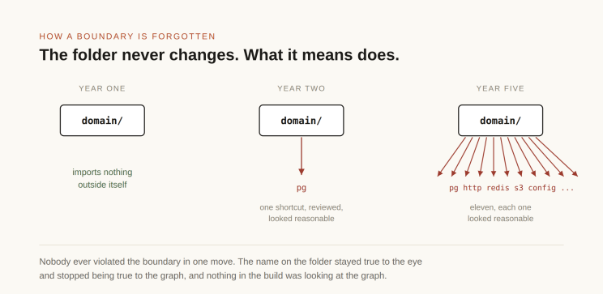
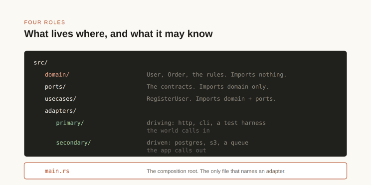
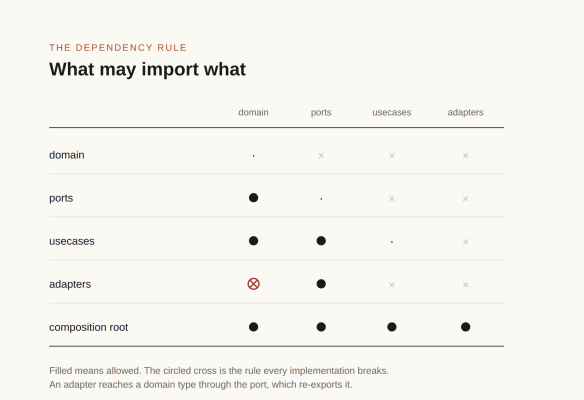
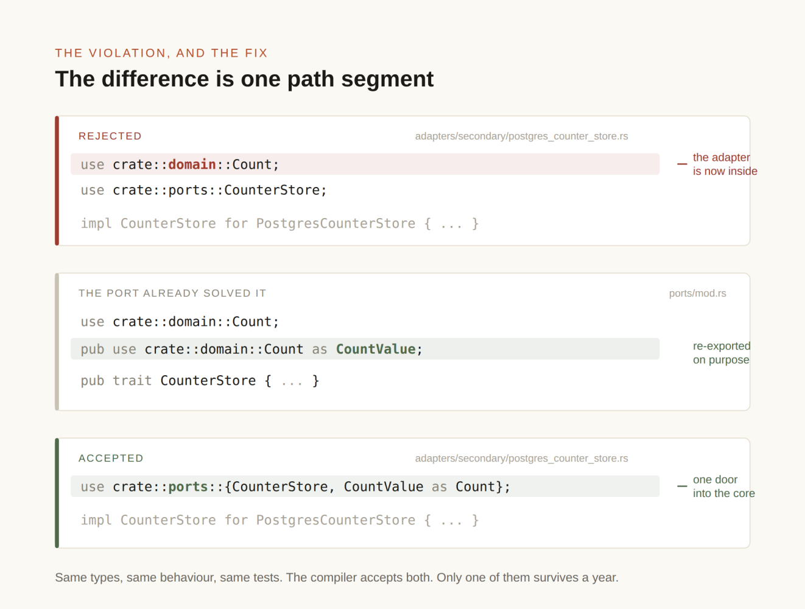
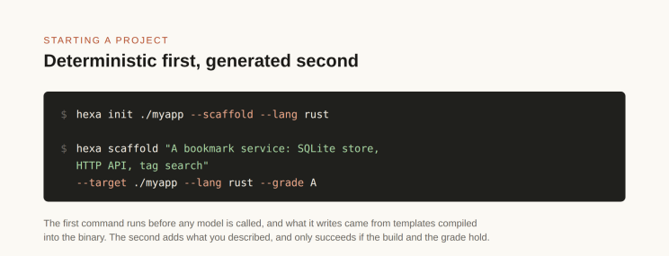
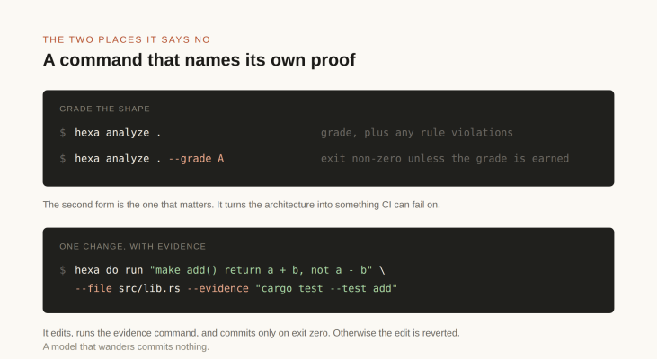
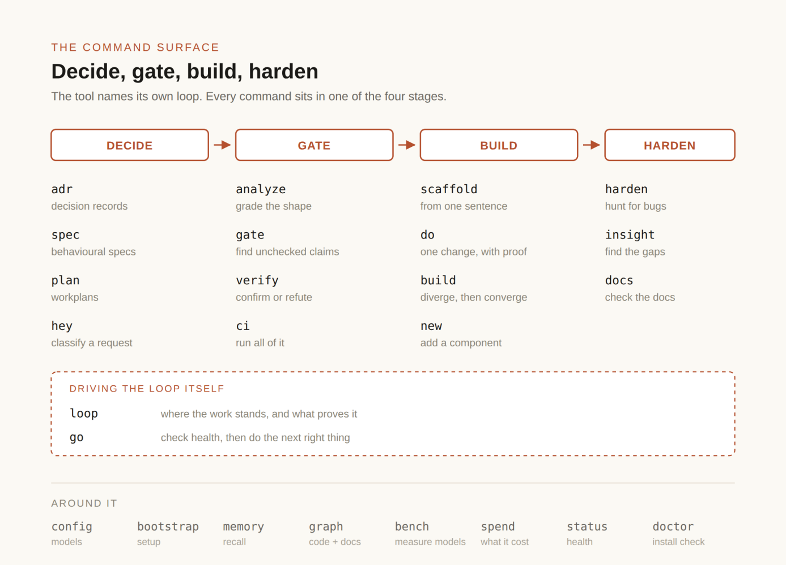
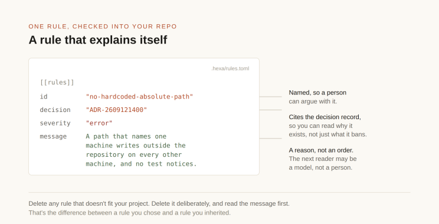
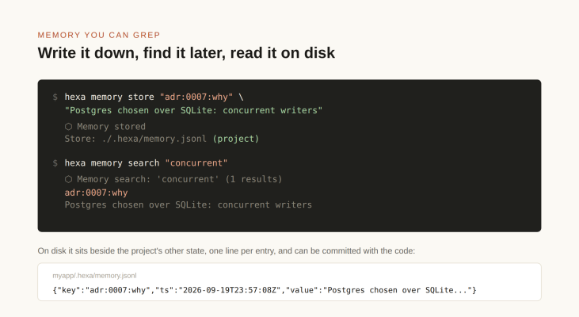
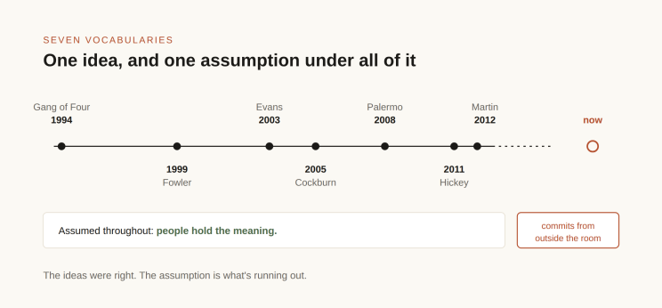

*For twenty years, good software depended on people remembering which parts of a program were allowed to talk to which. AI coding tools don't remember. So the rule has to be written down where a machine can enforce it.*

A growing share of new code is written by AI. [One peer-reviewed study](https://arxiv.org/abs/2506.08945v2) estimates that by early 2025 about 29 percent of new Python functions pushed to GitHub from the United States were AI-written, the highest rate the study measured, up from about 5 percent in 2022.

Some of it is being written by people who never worked as developers. I've been interviewing these teams, and the pattern is consistent: infrastructure groups who ran servers, storage and networks are building in-house software and agentic harnesses now, because AI made it possible to start. They're running into the same issues that plagued software engineering for years, how do I make sense of this code base especially if I wasn't the one who wrote it.

That matters for a reason that has little to do with whether the code works, and the reason is older than any of the tools.

In 2003 Eric Evans published a book called Domain-Driven Design.\[1\] People shelve it under architecture. It isn't really about architecture. It's about meaning: what a word is allowed to point at, and where one idea stops and the next one starts.

He gave the central practice a name and the first chapter of the book: crunching knowledge. It means you go to whoever actually understands the business and you stay in the conversation until the two of you use the same word for the same thing. Then, and not before, you write it into code.

That's slow, and the slowness is the point. It also turned out to predict, better than almost anything else, whether you could still change a system five years after it shipped.

Evans wasn't the first to say it, either. The line runs further back than most people remember.

In 1994 four authors published Design Patterns.\[2\] The patterns were never the prize; the vocabulary was. Give a team a shared word for a shape of problem and they stop explaining that problem to each other every six months. In 1999 Martin Fowler published Refactoring, which said something simple and unpopular: the structure of your code is a thing you can deliberately change, not a thing you inherit and suffer.\[3\] Evans came in 2003 with the strongest version of the claim, that structure ought to encode an understanding you negotiated with somebody, or it encodes nothing at all. Fowler then spent a decade carrying that idea to people who were never going to read Evans front to back.

Every one of those arguments was an argument about time. Skip the conversation and you go faster this quarter. You pay in some later quarter, when a change that should have touched one file touches forty.

All of it rested on an assumption nobody wrote down, because nobody had to: the people holding the vocabulary would be people.

That assumption is running out, and I don't think enough people have noticed.

Before we go on, I should say I wrote [hexa, the tool](https://github.com/gaberger/hexa) in the second half of this piece. It's open source, it's alpha, and I'll be specific about what it doesn't do.

Don't take my word for the numbers about the tool. The [README](https://github.com/gaberger/hexa/blob/1c96da2/README.md) explains what each one measures, and every one has a command behind it that you can run yourself; the full list is on the project's [evidence page](https://github.com/gaberger/hexa/blob/1c96da2/docs/EVIDENCE.md).

The argument is older than the tool. Put a file in a folder and you've said what that file is allowed to use. Nothing checks whether that stays true. Evans had a name for the question underneath: bounded context. What are you building, who is it for, and where are the seams, the places where a word stops meaning one thing and starts meaning another?

### The other hard problem

There's a line every programmer has heard, usually credited to a Netscape engineer named Phil Karlton: there are only two hard things in computer science, cache invalidation and naming things. People repeat it as a joke about what to call a variable. The attribution holds up better than most of our folklore. Karlton's son David has written that his father used the line at Netscape, and Fowler's note is where most of us picked it up. There's no contemporaneous written source, though, which is worth knowing before you put it in quotation marks.\[4\]

Read as a joke it's thin. Read as a claim about meaning it's exactly right. Naming is hard because a name is a compressed argument about what a thing is, and you have to make that argument before you understand the thing well enough to make it. But the line has a second half nobody quotes, because nobody noticed it was there. The hard problem isn't only what to call something. It's where to put it.

Open any codebase and read the folder names. utils. services. models. domain.

That isn't a caricature. [A 2026 preprint](https://arxiv.org/abs/2605.16701) of ten thousand actively maintained projects on GitHub found a folder called utils in about a quarter of them, the ninth most common folder name there is, and more than double its share a decade earlier.\[5\] The same study found files of instructions written for AI coding agents already sitting in nearly one project in ten.

Each of those is a claim. It says what goes inside, and it says what the thing inside is allowed to touch. A validator sitting in utils is announcing that it's a convenience, take it or leave it. Move that same file into domain and it's announcing something much bigger: this is a rule about the business, and the rest of the system bends around it.

Same code. Different address. The address is the argument.

The trouble is that, in most projects, nothing checks. Tools that can check do exist, ArchUnit for Java, dependency-cruiser for JavaScript and import-linter for Python among them, but plenty of projects never set one up. Nothing stops utils from reaching into services. Nothing stops a domain model from importing a database driver. An import is exactly what it sounds like, a line at the top of a file saying this code needs that code to work, and every rule in this piece is a rule about those lines. So the label and the reality drift apart, slowly, over years, and you never see it happen because every single step looked reasonable to whoever took it. The next person opens the folder, sees what's in there, and puts their file alongside it. They've just inherited a boundary that stopped being true before they arrived.

So the boundary doesn't get violated so much as forgotten. The directory is still sitting there. Whatever it was supposed to mean is gone, and nobody can tell you when it went.



In 2011 Rich Hickey gave a talk called "Simple Made Easy" that supplies the words this argument needs.\[6\]

Simple, he said, is objective. The word comes from the Latin for one fold. Something is simple when it isn't braided together with other things, and you can judge that without reference to what you personally happen to be good at.

Easy is different. Hickey traces it to a root meaning to lie near, and it's relative to you: close at hand, familiar, within reach of what you already know how to do. Two people can look at the same choice, disagree about whether it's easy, and both be right.

His verb for the failure is complect: to braid together things that didn't have to be braided. We do it because it's easy, and we don't feel the price at the time, because the price arrives later as every future change having to unpick the braid first.

Daniel Kahneman published Thinking, Fast and Slow the same year, and his two systems line up with Hickey's two words closely. System 1 is fast and associative. It reaches for whatever is familiar and near, and hands you an answer that feels right before anything has been checked. That is easy, felt from the inside. System 2 is slow and deliberate, and it's the only one that can ask whether two things had to be braided at all. It's also lazy, in Kahneman's word: most of the time it signs off on whatever System 1 proposed without looking. Complecting is what that sign-off looks like in code.

That braid shows up somewhere ordinary: a directory.

You make a claim every time you create one. Put your business rules in one place and your database code in another, and you've just asserted that those two things aren't braided together. That's simplicity in Hickey's sense, written in paths instead of in a sentence.

And because you wrote it that way it doesn't look like an assertion at all. It looks like filing. Nobody argues with filing, so nobody checks it, and a claim nobody checks is free to be wrong for years.

### The shape has a history

The structure I keep pointing at has been arrived at three times, under three names. When that happens it usually means the idea is real and not a fashion.

Alistair Cockburn described it first, around 2005. He called it ports and adapters, and reached for the hexagon only because he needed to draw a shape with more than four sides so nobody would assume there was a top and a bottom.\[7\] His insight was symmetry. An application shouldn't know whether the thing driving it is a user, a test harness, or a nightly job. It shouldn't know whether the thing it's persisting to is Postgres, a file, or a stub. Everything outside plugs in through a port.

Jeffrey Palermo arrived at nearly the same place in 2008 and called it onion architecture, in a four-part series whose first installment went up on July 29 of that year. He was careful about the claim. Not completely new, he wrote, but worth proposing as a named pattern, because a name gives people a common vocabulary to argue in.\[8\] His framing was concentric rings with the domain model at the center and every dependency pointing inward. He was arguing against the layered diagrams of the time, the ones with the database drawn at the bottom holding everything else up, which had the dependency exactly backwards. In Palermo's version the database is an outer ring. It's a detail.

Robert Martin consolidated both into clean architecture in 2012 and gave the shared principle a name: the dependency rule.\[9\] Source code dependencies point only inward, toward higher-level policy.

Three names, one claim: the domain owes nothing to the infrastructure. And you can check whether it's true by looking at which way the arrows run.

### What the shape actually is

Strip away the hexagons and the onions and you have four roles. That's all it is.

The domain holds the business concepts and the rules about them. What an order is. When it can be canceled. What makes a discount valid. It imports nothing but itself, the standard library, and whatever you allow on purpose: no database driver, no HTTP library, no framework. The test is simple. If you could explain it to the person who runs the business, and they would recognize it, it belongs here.

A port is an interface the domain writes in its own words. The domain says it needs somewhere to keep counters, or a way to send a receipt, and writes that down as a trait or an interface with no mention of how. Inside the project, ports import the domain and nothing else. They're the only vocabulary the outside is allowed to use when it talks to the inside.

An adapter implements a port using one specific technology. Adapters are where the mess lives, and the mess stays contained because an adapter can be deleted and replaced without the domain noticing. They come in two kinds, which is the part most explanations skip.

A driven adapter is the one people picture: Postgres, S3, an HTTP client, an in-memory fake for tests. The application calls out through a port, and the adapter answers.

A driving adapter runs the other way. An HTTP router, a CLI, a scheduled job, a test harness. The world calls in, and the adapter turns that into a use-case call. It's an adapter for the same reason the database one is: it translates between something outside and the vocabulary inside, and the inside never learns which one it was talking to.

That symmetry is Cockburn's actual point, and the reason he refused a diagram with a top and a bottom. A layered picture puts the user interface above and the database below, which quietly says they're different kinds of thing. They aren't. Both are outside. Both plug in. A person filling in a form and a test calling a function come through the same door, and swapping your web framework is the same category of operation as swapping your datastore.

The composition root is the one file, usually beside main, that knows which adapter satisfies which port and wires them together at startup. It is the only place in the program allowed to name a concrete adapter out loud.



Follow one request through and the inversion stops being abstract. HTTP arrives at an adapter, which translates it into a use case call. The use case works entirely in domain terms and, when it needs to persist something, calls out through a port. That port happens to be answered by the Postgres adapter, because the composition root said so at startup. The domain never learns that Postgres exists.

Look at what that is in Hickey's terms. A dependency rule is a simplicity claim written as a graph. It says these two things are not braided, and unlike a coding standard, you can prove it false. Point at an import and the rule is broken. That turns out to matter enormously once the person who wrote the import isn't a person you can go talk to.

Think about what we usually say about code. Readable. Clean. Well-factored. Loosely coupled. Not one of those can be shown to be false. Which means not one of them can be enforced. Which means every one of them, in the end, comes down to whoever argues hardest in review. A dependency rule isn't like that. It names one edge in one graph and says that edge may not exist. The edge is there or it isn't. That's rare in software, and it's the property that lets a design decision outlive the person who made it.

### Agents break the arithmetic

For twenty years we got away with this, because it was slow. A person adds a few files a day and stops to think about the awkward ones. Somebody notices the mess eventually and complains in review. The system corrects itself, badly and late, but it corrects.

Coding agents break that arithmetic, though not in the way people usually complain about.

An agent wasn't in the room when you and the domain expert fought about what "order" means. It doesn't know your system answers that question one way in billing and a different way in shipping, on purpose. What it has is your repository and whatever it can hold in view at once, which people call its context window, and out of that it works out where a new thing goes by matching the shape of what's already there.

Now put Hickey's two words on that and watch what happens. An agent is a magnificent engine for easy. Easy means near, and near is exactly the thing a model can compute. What's near in the file. What's near in the context window. Which pattern sits closest to the one it's been told to extend.

Simple is a different animal. Simple needs you to know what the braid was supposed to look like, and that knowledge was never in the repository. It was in the room.

So the agent gets very good at the thing it can see and stays blind to the thing it can't. A good new hire is blind the same way on day one. What differs is volume and hesitation. The new hire places three files and stops to ask about the fourth. An agent places a hundred and asks about none of them, and each one looks right: it compiles, it follows local convention, it passes review. Reviewers are checking whether the code works, not whether the folder still means what it says.

So the failure isn't bad code. It's plausible code that quietly cuts the model loose from the thing it was built to describe. Evans's whole argument was that the model is the asset. Lose it and you've still got working software, right up until the day you need to change it.

### The wrong question

The reflex at this point is to ask how we teach agents better judgment. I think that's the wrong question, in the same way that "hire better engineers" was always the wrong answer to architectural rot. Judgment doesn't scale. It never did. We just never had to face the fact at a hundred commits a day.

In practice, teaching judgment means writing it down in a file the agent reads at the start of each session, and the GitHub preprint I mentioned earlier found one in nearly one project in ten. Those files help. But an instruction is advice. The agent weighs it against everything else in view, and when the nearest pattern points the other way, the pattern can win. Nothing fails when that happens, and nothing tells you it did.

The question I'd rather ask is whether the boundary can be checked by a machine.

### A rule a machine can settle

That is the bet behind [hexa](https://github.com/gaberger/hexa), an open-source tool I have been building.\[10\] It generates new projects, a step programmers call scaffolding, in Cockburn's layout, a domain that knows nothing about the outside world, ports that define how the outside world may ask, and adapters that do the actual talking to databases and APIs. Then it grades what came back. The generator is for new work; the grader runs on any repository.

The rules fit on one screen. Domain imports only domain. Adapters import ports and never reach the domain directly, and when an adapter needs a domain type it gets it because the port re-exports it, so every adapter has exactly one door into the core. The rest follows from those two:



Those are claims about a graph, not claims about taste, and a machine can settle them. "Good separation of concerns" can't be graded. This can.

I'm not replacing your linter. Your compiler already catches type errors and your linter already catches the dead variable and the unreachable branch, and both are better at that than anything I'd write. hexa runs them. Its own code gets linted like everything else.

What neither of them knows is where a file sits and what it's therefore allowed to import. A compiler will happily compile an adapter that reaches straight into the domain. A linter has no opinion about it. Nobody ever told either one there was a boundary, so neither can tell you the boundary broke.

That's the layer the analyzer adds, and it reads the code with a general-purpose parser (tree-sitter) instead of the compiler. Parsing rather than building has a nice consequence: you can check the shape of code that doesn't compile yet, which is exactly the state an agent leaves your repository in halfway through a change. The checkers I named earlier run as part of a build, on code a person has finished. hexa runs the same kind of check inside the loop that writes the code, before a change is kept, so the structure gets graded as it evolves instead of audited after it has drifted.

There's a popular alternative that sounds more rigorous than this and isn't: write the specification first, then have the agent implement it. The trouble is that a spec is prose, and prose cannot fail. Code drifts away from a document in silence, because nothing ever runs the document. This project keeps decision records, or ADRs: short files that say what was decided and why, so the next person can read the reasoning instead of guessing at it. A hundred and fourteen of the ones the code and the documentation pointed at turned out to have no file behind them. The citations resolve now, because somebody wrote a stub for each one. The decisions themselves are still gone. A check that actually runs differs in one way, and it's the way that counts. It can fail.

### What it catches

What it catches is boring. That's the whole point.

An agent gets told to add a database-backed repository. It writes the adapter. On line four it imports the domain model directly, two directories up. Shortest path. Works immediately. Every test passes.



Nothing about that line looks wrong. It's the import your editor would autocomplete, and it's the easiest line in the file. It's also the one direction the architecture forbids, because Cockburn's symmetry only holds while the adapters stay outside, and that import just put one of them inside.

The port already solved this. The fix is to let it.

One re-export, and the adapter has exactly one door into the core. That's the difference between a datastore you swap by editing one file and a datastore that's grown into your business rules. The decay always runs the same way: one direct import, then eleven, and before long you can't test the domain without a live database.

And look at what the names are doing while the addresses do their work. The port is called CounterStore. Not PostgresStore, not SqlCounterRepository. It says what's needed and refuses to say how, which is why an in-memory map and a Postgres row satisfy it identically. Put a name like that in ports/ and the two claims check each other: the address says this file may not know about databases, and the name says it doesn't want to. A port that mentions a table or a connection string has already leaked, and you can see the leak in the name before you read a line of the body.

That's the whole argument in one file. Naming and placement were never separate problems. The name is the claim and the address is the jurisdiction, and neither one is worth much without the other.

The check fails it anyway, and names the file and line.

Now look at what didn't have to happen. Nobody had to know better. The agent didn't need the meeting it was never invited to. No reviewer had to catch it late on a Friday. The boundary held by itself.

### Why only typed languages

hexa scaffolds Rust, Go and TypeScript, and that restriction isn't a preference. Both checks depend on it.

The first reason is speed. The loop is: edit a file, compile it, read the error, edit again. That loop runs at the speed of the compiler. In a typed language a wrong shape falls over in seconds, before any test runs at all. In a dynamic language the same mistake sits there waiting for a test that may never have been written, which means the first thing to object to the agent's work is a test the agent wrote itself. That's not much of an objection.

The second reason is whether you can see the boundary at all. To walk an import graph you need imports that are explicit and resolvable without running the program. Dynamic languages can be checked this way too, and import-linter does it for Python, but runtime module loading can hide an edge from any static tool, and duck typing means no compiler is there to reject the wrong shape first. Where you can't read the graph you can't grade the architecture, and the argument falls back to taste.

The three aren't equally strict, though. Rust is the fussiest. TypeScript lets more through, and anyone in a hurry can switch its checks off one flag at a time. I saw what that means when I ran the same job through a handful of small models on my own machine. The weaker ones wrote TypeScript that passed. They couldn't get Rust to compile at all. That's a small test, so don't treat it as a benchmark. Still, the lesson is plain enough: the looser the language, the more weak work gets through, and the strict one is quietly doing some of your checking for you.

If you're counting on the compiler to be the first reader of an agent's output, then a language decision you made years ago is quietly deciding how much that reader catches today.

### What using it looks like

Who runs what, first, because it's easy to lose track. You run hexa from the command line, to start a project, make a change, or grade what's there. When a change needs code written, hexa hands the job to whichever model you've configured and checks the result before anything is kept. If you already work inside a coding agent, the hooks hexa installs ride along in that session: they show where the work stands when it opens, and they stop a large edit that hasn't said how it will be proved. hexa also installs a set of skills, short instructions telling the agent which hexa command to run for a given job. There's no server sitting in the middle: the agent runs the same commands you would. And your build server runs the grade on every change, the way it already runs your tests.

It's one binary, no background service and no database, and it checks two things before it lets a project through: that the thing builds, and that its shape holds.



The first check is the build itself, and it runs before any model is called. What it checks was not written by a model either. The starting code comes from templates compiled into the binary, so the same command produces the same bytes on every machine. The order matters here. If the starting code will not compile on your laptop, nothing you measure after it means anything.

The second check is the shape: the dependency rule from earlier, enforced.



That's what turns the architecture from a diagram into something a build pipeline can fail on. --grade A in a scaffold means you don't get a successful build unless the boundaries held.

Day to day the loop is smaller than a whole scaffold. One change goes through hexa do run, the lower panel above, and that command has to name its own proof.

It edits the file, runs the command, and commits only if the command succeeds. Otherwise the edit gets reverted. A model that wanders commits nothing, which is a very different posture from a model that commits and waits to be caught.

That's two commands. The others aren't the point of this piece, and I'll walk through hexa properly in a follow-up. Their arrangement is the point here. hexa is built around a loop it names for itself, and every command sits in one of the four stages.



The rules then travel with the project. Every scaffold writes a rules file and checks it into the repository, so it's a file you own and edit rather than something buried inside the tool. It defines which paths count as which layer, then lists the rules by name. Because the layers are matched by path, the same file works on a tree hexa didn't generate. Each one cites the decision record that justifies it, so anybody who trips a rule can go read why it exists instead of only what it forbids:



Note the message. It gives the reason, not just the offense, which matters because the thing reading it next may be a model rather than a person. The template ships with an instruction attached: delete any rule that doesn't fit your project, but delete it deliberately, and read the message first. That's the difference between a rule you chose and a rule you inherited.

An ADR is one decision written down, once: an id, a date, what pushed us into it, what we decided, what it costs, and the command that proves it still holds. When the decision changes you don't edit the file. You write a new one and mark the old one replaced, so it stays a dated argument instead of a document that quietly rots. Here is a real one from this project, cut down:

```markdown
---
id: ADR-2609211200
status: accepted
date: 2026-09-21
---
# ADR-2609211200: Memory belongs to the project it was learned in

Drivers: hexa memory wrote to one file per user. Two repositories worked on
by the same person shared one memory. Reproduced: a note stored in /tmp/probe
was listed in an unrelated directory that had never been scaffolded.

Decision: memory is project-scoped by default. The store is
<project>/.hexa/memory.jsonl. Outside a project it is ~/.hexa/memory.jsonl.

Consequences: a lesson stored in one repository no longer reaches another's.
That is the point, and it is also the migration cost: entries written before
this change stay in the old file and have to be re-stored.

Gate: cargo test -p hexa-cli --test memory_is_project_scoped, written first
and shown failing against the previous code.
```

That is the whole idea. The decision, the price, and a command that fails if the decision stops being true. A rule in the rules file cites that id, so the rule and the reasoning stay attached to each other.

hexa checks the records themselves, too. hexa adr doctor reads every decision id mentioned anywhere in the code or the docs and fails the build when one points at a file that isn't there, and it runs on every push. That check is what turned up the hundred and fourteen missing decisions from earlier. A rule nobody checks drifts, and so does a decision nobody can find.

Rules are one kind of thing that outlives a session. Knowledge is the other, and it's the harder one, because most of what a team knows about its own boundaries was never written anywhere.

So hexa keeps a memory. Not a metaphor for one: a store you can write to, search, list and delete from the command line. It lives in the project, in .hexa/memory.jsonl next to the rest of the project's state, so it can be committed with the code it describes. Outside a project it falls back to a store in your home directory, and a flag reaches that one on purpose.



Some of it gets written deliberately, the way that one was. Some of it gets written without anyone asking, by hooks that fire at the edges of a session. When work stops, a checkpoint goes down recording which plan was open, which stage it had reached, and how many edits had landed. When the next session starts, that checkpoint is read back and the work resumes instead of beginning cold. The agent can search the store mid-task, so what one session learned is available to a later one that never shared a context window with it.

hexa also reads its own transcripts. One command scans recent sessions for the gaps the assistant admitted to along the way, the numbered lists of things it noticed and moved past. Anything acknowledged and never routed anywhere becomes a finding. That's a system mining its own confessions for work it still owes.

Go back to what Evans was describing. The knowledge that made a boundary mean anything lived in the people who negotiated it. That was never a problem because memory was involved. It was a problem because you couldn't list that memory, couldn't search it, couldn't check whether it still matched the code, and it walked out of the building when somebody took another job. A memory that's a file has none of those properties. You can read it, search it, correct it when it's wrong, and delete it when it stops being true.

### Does it actually hold

Claims about architecture are cheap, so let me show you results instead of asserting things. Six projects, each generated from a single sentence, with Claude Code driving hexa, and every check re-run independently from a clean build. Three more sit in the repository as deliberate bad cases, kept because they fail. One of the six is a real service with an HTTP API, a SQLite store and a live listener, and I broke its tests on purpose to prove they could fail: changing an HTTP status failed four tests, breaking a domain rule failed three more, and putting both back returned twenty-seven out of twenty-seven. A passing test proves nothing until you've watched it fail.

### Two kinds of limit

No enforcement catches everything, and this one says where it stops. It reads the code as written. A macro, a shorthand the compiler expands into more code, can come from a library the core is allowed to use and expand into something that touches the file system, and the check never sees it, because that code doesn't exist until the compiler writes it. The docs name exactly three things the check can't see, and that's one of them. That sentence sits in the docs rather than in a bug report somebody files later.

A controlled limit is one you know about, bounded and written down. You can build on it because you know where it stops.

A hidden limit is the one you find out about after you've built on the assumption that it held.

A convention nobody checks is the worst of both. It covers nothing, and when it stops being true, nothing says so. You find out during an incident. A rule that gets checked and writes down where it stops is the opposite on both counts, and it's a far smaller claim than "we have good architecture." It's also worth more.

### What they assumed

The Gang of Four in 1994. Fowler in 1999. Evans in 2003. Cockburn in 2005. Palermo in 2008. Hickey in 2011. Martin in 2012. Eighteen years, seven vocabularies, one idea. Meaning has to be negotiated, then held in common, or the software stops describing the thing it was built for.



They all assumed people would do the holding. Shared memory, shared vocabulary, shared taste.

That's the part that's breaking. The ideas were right. What changed is that a growing share of the commits now come from something that was never in the room, and that happens to be very, very good at easy.\[11\]

A name is a promise about one thing. A directory is a promise about a graph. Both can still be kept, and keeping them was never really a memory problem. It was a question of where the memory lived. In somebody's head it can't be read, can't be checked, and leaves when they do. Written down where a machine can test it against the code, it stays, and it tells you the day it stops being true.

------------------------------------------------------------------------

> Gary Berger is Global Field CTO at Forward and the author of hexa, which is open source under the MIT license and, at the time of writing, alpha software.

### References

1.  Eric Evans, Domain-Driven Design: Tackling Complexity in the Heart of Software, Addison-Wesley, 2003. Chapter 1 is "Crunching Knowledge"
2.  Erich Gamma, Richard Helm, Ralph Johnson and John Vlissides, Design Patterns, Addison-Wesley, 1994
3.  Martin Fowler, Refactoring: Improving the Design of Existing Code, Addison-Wesley, 1999
4.  On the Karlton line: David Karlton, [Naming things is hard](https://www.karlton.org/2017/12/naming-things-hard/), 2017, and Martin Fowler, [TwoHardThings](https://martinfowler.com/bliki/TwoHardThings.html)
5.  Andre Hora, João Eduardo Montandon and Diego Elias Costa, [What's Inside a GitHub Repository? An Empirical Study on the Contents of 10K Projects](https://arxiv.org/abs/2605.16701), 2026
6.  Rich Hickey, [Simple Made Easy](https://www.infoq.com/presentations/simple-made-easy), Strange Loop, 2011. [Transcript](https://github.com/matthiasn/talk-transcripts/blob/master/Hickey_Rich/SimpleMadeEasy.md)
7.  Alistair Cockburn, [Hexagonal Architecture](https://alistair.cockburn.us/hexagonal-architecture/), 2005. Cockburn's own account is that the name was a placeholder chosen before he understood what the sides stood for, and that the pattern is properly called Ports and Adapters
8.  Jeffrey Palermo, [The Onion Architecture, part 1](https://jeffreypalermo.com/2008/07/the-onion-architecture-part-1/), July 29, 2008
9.  Robert C. Martin, [The Clean Architecture](https://blog.cleancoder.com/uncle-bob/2012/08/13/the-clean-architecture.html), August 13, 2012
10. [hexa](https://github.com/gaberger/hexa)
11. Simone Daniotti, Johannes Wachs, Xiangnan Feng and Frank Neffke, Who is using AI to code? Global diffusion and impact of generative AI, Science 391 (6787), 2026, pp. 831-835. The link in the text goes to the authors' [open copy on arXiv](https://arxiv.org/abs/2506.08945v2), since the journal version is paywalled

---

*Originally published on [LinkedIn](https://www.linkedin.com/pulse/rules-nobody-wrote-down-gary-berger-l70xc).*
